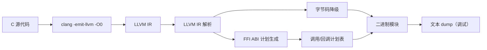
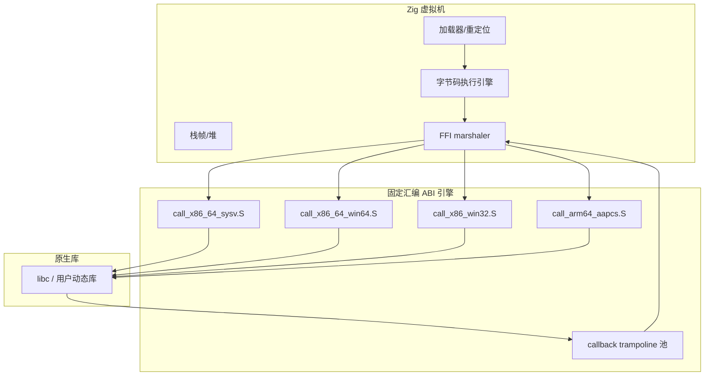

# C 解释器架构与关键决策

> 本文记录已实现的架构、决策、ABI 细节、已知边界、验证证据和范围外项。

## 1. 产品概述

实现一个完整的 C 语言解释器系统，包含 Python 编译器前端和 Zig 运行时虚拟机。前端用 clang 生成 LLVM IR，Python 将其降为紧凑的栈式字节码，并为每个外部调用/callback 生成 ABI 计划；运行时用 Zig 实现字节码解释器，用**固定汇编 ABI 引擎**按计划完成原生调用和 callback，不链接 libffi，不使用 `@call` 桩矩阵，不申请动态可执行内存。

设计目标：

- **产物小**：没有 256/struct 桩矩阵；FFI 引擎是每个 ABI 一段固定汇编 + Zig 侧计划解析。
- **C FFI 直接**：所有 VM 指针就是宿主指针，结构体布局与宿主 ABI 一致。
- **无动态可执行内存**：没有 JIT、没有 libffi closure、没有运行时代码生成；回调用静态 trampoline 池。
- **编译期决定 ABI**：前端知道所有签名，生成寄存器/栈位置、结构体分类、varargs 和 callback 反向计划；运行时只执行。
- **平台**：SysV x64、Win64、Win32、AArch64 AAPCS64 均已实现并通过真实环境交叉验证；ABI 计划按目标 ABI 生成。

## 2. 已确认决策

- **运行时语言**：Zig 0.13（pin）。
- **前端**：Python + clang LLVM IR（`-O0`），不使用 libclang AST。
- **平台**：Linux x64、Windows x64、Windows x86、Linux ARM64 已实现；32 位仅 Windows x86，不做 Linux i386/ARM32。
- **C11 范围**：核心 C11 + 结构体 FFI。
- **FFI**：不链接 libffi，不使用 `@call` 桩矩阵，不申请动态可执行内存；编译期生成 FFI ABI 计划，运行时用固定汇编引擎执行；callback 用静态 trampoline 池 + 反向计划。
- **ABI 顺序**：Linux x64 → Windows x64 → Windows x86 → Linux ARM64（已完成）。
- **Callback 池**：固定 256 槽；当前仅 SysV x86-64 接入，其他 ABI 是剩余工作。
- **编译器发布方式**：仅构建期使用；发布物是 Zig 运行时 + 字节码。

## 3. 核心功能

### 3.1 编译器（Python，build-time）

- **前端**：调用 `clang -S -emit-llvm -O0 -g` 生成 LLVM IR，不依赖 libclang Python 绑定。
- **IR 生成**：把 LLVM IR 降为基于栈的字节码。
- **FFI ABI 计划**：为每个外部调用/callback 生成寄存器/栈位置、结构体分类、varargs 信息和反向计划。
- **输出格式**：二进制字节码为主；文本格式仅用于调试 dump。
- **错误报告**：带源文件/行号的编译错误；不支持的 LLVM IR 模式明确报错。

### 3.2 运行时 VM（Zig）

- **字节码解释器**：栈式 VM，固定 8 字节栈槽。
- **动态符号链接**：Linux 用 `dlopen`/`dlsym`，Windows 用 `LoadLibraryA`/`GetProcAddress`；`--lib` 加载的句柄会被搜索后再回退到 CRT。
- **FFI 桥接**：
  - Zig 侧按 ABI 计划把 VM 值搬进 `ABIFrame`（GPR/XMM/栈/sret）。
  - 每个 ABI 一段固定汇编引擎，负责装载寄存器/栈、调用目标、捕获返回值。
  - 回调用静态 trampoline 池捕获参数，Zig dispatcher 按反向计划调用 VM 函数；目前仅 SysV。
  - 不链接 libffi，不使用 `@call` 桩，不产生动态可执行内存。
- **C ABI 导出**：运行时导出 `ci_vm_*` 纯 C ABI，可被 cffi、C/C++、其他语言直接调用。
- **跨平台**：Linux x64（SysV）、Windows x64、Windows x86、Linux ARM64（AArch64）由编译期 `ffi/platform.zig` 选择 frame/引擎/loader。

## 4. 技术栈与目标平台

### 4.1 编译器部分（Python）

- **语言版本**：Python 3.10+
- **前端**：clang 可执行文件（pin 版本，例如 clang 16+），通过 subprocess 调用
- **标准库**：`dataclasses`、`struct`、`argparse`、`pathlib`
- **测试**：`pytest`

不引入 libclang Python 绑定。

### 4.2 运行时部分（Zig + 汇编）

- **语言版本**：Zig 0.13（pin 具体版本；0.14 改了 `CallingConvention` 语法，暂不升级）
- **构建系统**：`zig build`；`.S` 文件由 clang 集成汇编器编译
- **平台 API**：
  - Linux：`std.DynLib` 或 `dlfcn.h`
  - Windows：`LoadLibraryA`/`GetProcAddress`（`ffi/native.zig`）
- **FFI**：编译期 ABI 计划 + 固定汇编引擎；不链接 libffi，不使用 `@call` 矩阵
- **无动态可执行内存**：无 JIT、无 closure、无运行时代码生成

### 4.3 ABI 支持矩阵

| ABI | 状态 | 说明 |
| --- | --- | --- |
| x86-64 System V | 已实现 | Linux x64；`call_x86_64_sysv.S` |
| x86-64 Microsoft | 已实现 | Windows x64；`call_x86_64_win64.S` |
| x86 Microsoft 32-bit | 已实现（cdecl） | Windows x86；`call_x86_win32.S`；stdcall 计划待补 |
| AArch64 AAPCS64 | 已实现 | Linux ARM64；`call_arm64_aapcs.S`；x0-x7/v0-v7 |

## 5. 总体架构

### 5.1 编译器架构



### 5.2 运行时架构



## 6. 前端设计

### 6.1 clang LLVM IR

调用方式：

```bash
clang -S -emit-llvm -O0 -g -fno-discard-value-names -o program.ll program.c
```

选择 `-O0` 的原因：

- 局部变量以 `alloca` + `load`/`store` 形式存在，几乎没有 phi 节点，栈化接近 1:1。
- 不需要实现 mem2reg、SSA 构造、复杂优化 pass。
- 后续可选 `-O1`，但需要补 phi 处理，不作为 v1 必需项。

Python 侧用标准库解析文本 LLVM IR（大文件可选 llvmlite，但默认不引入）。

支持的 LLVM IR 子集：

- 函数、基本块、全局变量、常量、字符串。
- 内存：`alloca`、`load`、`store`、`getelementptr`。
- 算术：`add`、`sub`、`mul`、`udiv`、`sdiv`、`urem`、`srem`、`fadd`、`fsub`、`fmul`、`fdiv`、`frem`。
- 位运算：`shl`、`lshr`、`ashr`、`and`、`or`、`xor`。
- 比较：`icmp`、`fcmp`（含谓词）。
- 转换：`trunc`、`zext`、`sext`、`fpext`、`fptrunc`、`fptosi`、`sitofp`；`x86_fp80` 目前按 16B 存储/64-bit 精度处理。
- 控制流：`ret`、`br`、`switch`。
- 聚合：`extractvalue`、`select`；`insertvalue` 未支持。
- 调用：`call`；内部函数调用降为 VM `CALL`，外部声明降为 `CALL_NATIVE`/`CALL_VARARG`。
- 内建：`llvm.memcpy`、`llvm.memset`、`llvm.lifetime.*`（lifetime 可忽略）。

当前明确不支持：`invoke`、`indirectbr`、内联汇编、向量类型、`atomic` 指令、异常/展开、phi/`-O1`、`fptoui`/`uitofp`/`ptrtoint`/`inttoptr`/`bitcast`、`insertvalue`、`va_start`/`va_arg`。

降级规则：

- 每个 LLVM SSA 值映射到栈槽或临时栈项；`-O0` 下无需 phi 处理。
- `alloca` 分配当前函数帧槽位；`load`/`store` 生成带类型标签的 `LOAD`/`STORE`。
- `getelementptr` 优先折叠为常量字节偏移；不能折叠时生成 `PTR_ADD`。
- `icmp`/`fcmp` 生成 `CMP_*` + 谓词。
- `br` 生成 `JMP`/`JZ`/`JNZ`；`switch` 生成 `SWITCH`。
- `memcpy`/`memset` 生成 `MEMCPY`/`MEMSET`。
- `extractvalue` 生成字段偏移 load/store；聚合 store 使用 `MEMCPY`。
- 源位置从 `!dbg` 元数据提取，生成 `LINE_INFO`（可选）。

类型与布局：

- LLVM 类型直接映射：`i1/i8/i16/i32/i64`、`float`、`double`、`ptr`、数组、结构体。
- 结构体布局必须与 clang 的目标布局一致；前端根据 LLVM 结构体定义和目标对齐规则计算偏移，必要时用 `clang -Xclang -fdump-record-layouts` 交叉验证。
- 结构体赋值、union、bitfield、指定初始化器由 clang 降级为 load/store/shift/mask，前端不重复实现 C 语义。

### 6.2 字节码 IR 设计（基于栈）

采用栈式虚拟机，保持实现简单和字节码紧凑。

**设计原则**：

- 约 50 条通用 opcode + 1 字节类型标签，不按类型/位宽展开成 200 条。
- 同语义的有符号/无符号差异通过 opcode 或类型标签表达；加减乘不需要区分符号。
- 栈槽固定 8 字节；所有值按 8 字节槽存放，f32 存在低 32 位。
- 操作数使用 LEB128 变长编码；小立即数 1 字节。
- 所有指针是宿主指针，字符串 NUL 结尾，不做 handle 表或 moving GC。

**opcode 分类**：

1. **常量/局部变量**：`LOAD_CONST`、`LOAD_NULL`、`LOAD_LOCAL`、`STORE_LOCAL`、`LOAD_LOCAL_ADDR`、`LOAD_GLOBAL`、`STORE_GLOBAL`、`LOAD_GLOBAL_ADDR`。
2. **内存**：`LOAD`、`STORE`、`ALLOCA`、`MALLOC`、`FREE`、`REALLOC`、`MEMCPY`、`MEMSET`、`MEMMOVE`。
3. **整数算术**：`ADD`、`SUB`、`MUL`、`DIV_S`、`DIV_U`、`MOD_S`、`MOD_U`、`NEG`。
4. **浮点算术**：`FADD`、`FSUB`、`FMUL`、`FDIV`、`FREM`、`FNEG`。
5. **位运算**：`AND`、`OR`、`XOR`、`NOT`、`SHL`、`SHR_U`、`SHR_S`。
6. **比较**：`CMP_EQ`、`CMP_NE`、`CMP_LT`、`CMP_LE`、`CMP_GT`、`CMP_GE`；类型标签决定有符号/无符号/浮点。
7. **类型转换**：`EXT`、`TRUNC`、`ITOF`、`FTOI`、`F32_TO_F64`、`F64_TO_F32`、`PTR_TO_I64`、`I64_TO_PTR`。
8. **控制流**：`JMP`、`JZ`、`JNZ`、`SWITCH`、`CALL`、`CALL_INDIRECT`、`RET`、`RET_VOID`。
9. **指针/聚合**：`PTR_ADD`、`PTR_DIFF`、`GET_FIELD_PTR`、`GET_ELEM_PTR`。
10. **FFI**：`CALL_NATIVE`、`CALL_VARARG`、`DLOPEN`、`DLCLOSE`、`DLSYM`、`CREATE_CALLBACK`。
11. **杂项**：`NOP`、`POP`、`DUP`、`SWAP`、`LINE_INFO`、`BREAKPOINT`。

**类型标签**（1 字节）：

- `I8_S`、`I16_S`、`I32_S`、`I64_S`
- `I8_U`、`I16_U`、`I32_U`、`I64_U`
- `F32`、`F64`
- `PTR`、`VOID`

**编码格式**：

```text
[opcode:1][type_tag:1?][operand:LEB128?][operand2:LEB128?]
```

- 小立即数：1 字节；大立即数：LEB128。
- 跳转目标是字节码偏移（加载后重定位）。
- 二进制模块包含：magic/version/arch、常量池、字符串池、全局变量、函数表、字节码、FFI 计划表、行号表。

**栈帧**：

- 固定 8 字节槽；`local_count` 在加载时确定帧大小。
- `ALLOCA` 在 VM 栈上分配；`alloca` 动态大小也要支持。
- `CALL` 建立新帧；`RET` 恢复调用者帧。
- VM 必须可重入：native callback 可以再次进入 VM，帧和错误状态不能是全局单例。

### 6.3 FFI：编译期 ABI 计划

**核心思想**：

前端在编译 C 程序时已经知道每个外部调用/callback 的完整签名。它直接把这些信息编译成一份**ABI 计划**，说明每个参数/返回值在寄存器/栈/sret 中的位置。运行时不推断 C 类型，也不生成/选择 per-signature 代码，只按计划把值搬进 `ABIFrame`，然后调用固定汇编引擎。

这样：

- 没有 256 个 varargs 桩，也没有结构体桩矩阵。
- 不需要 per-program `.so` 或重新链接 runtime。
- 运行时是通用的；不同程序只带来不同的计划数据。
- 32 位 ABI 只是另一套计划生成规则 + 另一段汇编引擎。

**LLVM IR 已经做了 ABI lowering**：

- clang 会把小结构体参数 coerced 成 `i64`/`double`/literal aggregate；MEMORY 参数变成 `ptr byval(%struct.X)`；MEMORY 返回变成 `void + ptr sret(%struct.X)`。
- 因此前端生成器直接处理 lowered 类型/属性，不需要重新实现完整 C 结构体 ABI 分类；只需分类 clang 生成的 literal aggregate（如 `{ i32, double }`）以及处理 `byval`/`sret`。
- 这一点已由 `spike/callplan_gen` 端到端验证。

**计划内容**：

```zig
pub const Abi = enum(u8) {
    sysv64,          // Linux x86-64
    win64,           // Windows x86-64
    win32_cdecl,     // Windows x86
    win32_stdcall,
    aapcs64,         // Linux ARM64
};

pub const LocKind = enum(u8) {
    gpr,       // 通用寄存器，index = 0..N
    xmm,       // SSE/XMM 寄存器，index = 0..N
    stack,     // 栈偏移，index = 字节偏移
    sret,      // 隐藏返回指针
    rax, rdx, xmm0, xmm1, st0, st1, // 返回值位置
    void_,
};

pub const Loc = struct {
    kind: LocKind,
    index: u16,   // 寄存器编号或栈偏移
    size: u16,    // 拷贝字节数
    offset: u16,  // 在参数/返回值缓冲区中的偏移
};

pub const ArgPlan = struct {
    locs: []const Loc, // 结构体可能有多个 eightbyte 位置
    size: u16,
    align: u16,
    is_struct: bool,
};

pub const CallPlan = struct {
    abi: Abi,
    args: []const ArgPlan,
    ret_locs: []const Loc,
    stack_size: u16,
    stack_align: u16,
    sret: bool,
    sse_count: u8,       // SysV varargs 的 %al
    cleanup_bytes: u16,  // stdcall 被调方清理字节数
    is_varargs: bool,
};
```

> `spike/asm_abi_call` 和 `spike/callplan_gen` 使用的是上面类型的 x86-64 SysV 子集（`alignment` 字段、无 `st0/st1`/`cleanup_bytes` 等）；其他 ABI 实现时再扩展。

- 前端为每个不同的调用签名生成并去重一个 `CallPlan`；`CALL_NATIVE`/`CALL_VARARG` 携带计划 ID。
- 结构体参数按目标 ABI 拆成多个 `Loc`（例如 SysV 两个 eightbyte → 两个 GPR/XMM/栈位置）。
- 返回值：标量/浮点位置、结构体 multiple locations、sret 隐藏指针。
- varargs：计划包含实际变长参数的位置（clang IR 已经给出实际类型和默认提升）；SysV 的 `%al`、Win64 的浮点双写、Win32 的栈布局、ARM64 的 v0-v7/栈布局都在计划里。
- callback：生成反向计划，说明从哪些寄存器/栈位置读取参数、把返回值写回哪里、stdcall 的清理字节数。

**为什么不用 `@call`**：

- `@call` 需要 comptime 已知签名，导致 256/struct 桩矩阵。
- 固定汇编引擎 + 计划是数据驱动的：同一段汇编处理任意签名，计划由前端生成。
- 没有 per-signature 代码，也没有运行时动态代码。

### 6.4 Callback 反向计划

- 前端为每个 callback 签名生成 `CallbackPlan`：参数从哪些 GPR/XMM/栈位置读取、返回值写回哪些位置、stdcall 清理字节数。
- 运行时用固定 256 槽的静态 trampoline 池：
  - 每个 trampoline 把槽位号放进一个非参数寄存器（SysV 用 R11，Win32 用 EAX，ARM64 用 x16/x17），跳到公共入口。
  - 公共入口保存所有参数寄存器、XMM 和栈指针，调用 Zig `ci_callback_dispatch(slot, &frame)`。
  - dispatcher 按反向计划读取参数，压入 VM 栈，执行 VM 函数，把返回值写回帧的返回寄存器/缓冲区。
  - 入口恢复返回值寄存器并 `ret`；Windows x86 的 `stdcall` callback 按计划执行 `ret N` 或 `add esp, N`。
- 纯静态代码；不需要 `ffi_closure`，不需要可执行内存。
- 槽位表固定 256；descriptor 只读；callback 生命周期文档化。
- v1 单线程：原生线程回调暂不支持；如需多线程，先加锁或每线程一个 VM。

## 7. 运行时设计

### 7.1 ABIFrame

Zig 侧为每个 ABI 定义固定布局的帧：

```zig
pub const SysV64Frame = extern struct {
    gpr: [6]u64,       // rdi, rsi, rdx, rcx, r8, r9
    xmm: [8][2]u64,    // xmm0..xmm7 的低/高位
    sse_count: u8,     // %al
    stack: [*]u8,      // 栈参数缓冲区
    stack_size: usize,
    sret: ?*anyopaque,
    ret_rax: u64,
    ret_rdx: u64,
    ret_xmm0: [2]u64,
    ret_xmm1: [2]u64,
};
```

- `ffi/platform.zig` 在编译期按目标选择 `SysVFrame` / `Win64Frame` / `Win32Frame` / `Arm64Frame`，并提供 `configure/marshal/readRet/invoke/validate` 分派。
- Win64 frame：`gpr[4]`、`xmm[4][2]`、`sse_count`、shadow/stack、sret、RAX/RDX/XMM0/XMM1 返回。
- Win32 frame：`eax`、`edx`、`st0`、stack、`stack_size`、`conv`、`ret_x87`。
- ARM64 frame：`gpr[8]`、`vec[8][2]`、`sret`(x8)、stack、`ret_x0/x1`、`ret_v0/v1`。
- `marshal` 按 `CallPlan` 把 VM 栈值拷贝到 GPR/XMM/vec/stack/sret；结构体按 `Loc` 拷贝字节，保持位模式。
- varargs 按计划填槽；SysV `%al`、Win64 浮点 GPR/XMM 副本、Win32 全栈。
- 返回值按 `ret_locs` 从帧的返回寄存器/缓冲区读取；Win32 i64 用单个 8B `rax` loc 合并 EAX:EDX，float 从 ST0 转 f32。

### 7.2 固定汇编引擎

每个 ABI 一段 `.S`：

```asm
// ci_abi_call_sysv64(frame: *SysV64Frame, target: *anyopaque)
ci_abi_call_sysv64:
    // 保存 callee-saved
    // 按 frame.stack_size 对齐 RSP 并拷贝栈参数
    // 装载 xmm0..xmm7、rdi..r9
    // mov al, [frame + sse_count]
    // call target
    // 保存 rax/rdx/xmm0/xmm1 到 frame
    // 恢复并返回
```

- 汇编只做固定 ABI 的寄存器/栈装载和返回值捕获，不解析复杂签名。
- 计划解析、结构体分类、varargs 位置已在 Zig/前端完成。
- 实际引擎符号：SysV `ci_abi_call_sysv64`、Win64 `ci_win64_call`、Win32 `ci_win32_call`（asm 标签 `_ci_win32_call`）、ARM64 `ci_arm64_call`。
- Win32 引擎处理 cdecl 栈参数、调用者清理、`eax/edx/st0` 返回值；stdcall 计划尚未从编译器暴露。
- ARM64 引擎处理 x0–x7/v0–v7/栈参数，捕获 x0/x1/v0/v1 和 x8 sret；当前只捕获 v0/v1 两个返回向量。
- Win64 引擎处理 32B shadow space、位置相关的 XMM 编号、sret 对 GPR/XMM 的移位和 varargs 浮点副本；保存 RSI/RDI 等 callee-saved 寄存器。
- 每个 ABI 一段固定代码，不随程序增长。

### 7.3 Marshaler

- 输入：VM 栈上的参数值、`CallPlan`、目标函数指针。
- 填充 `ABIFrame`：GPR/XMM/stack/sret。
- 调用固定汇编引擎。
- 按 `ret_locs` 读取返回值并写回 VM 栈。
- 不做运行时 C 类型推断；所有类型/位置来自计划。

### 7.4 Callback trampoline

见 6.4。要点：静态 256 槽、公共入口保存寄存器/栈、Zig dispatcher 按反向计划执行、stdcall 清理、可重入。

## 8. 调用约定

### 8.1 x86-64 System V（v1）

- 整数参数：RDI、RSI、RDX、RCX、R8、R9。
- 浮点参数：XMM0–XMM7。
- 变长参数：`%al` = 使用的 XMM 数量。
- 栈 16 字节对齐；调用者清理栈。
- 返回值：RAX/RDX 或 XMM0/XMM1；大结构体 sret。

### 8.2 x86-64 Microsoft（Windows x64）

- 整数参数：RCX、RDX、R8、R9；浮点参数：XMM0–XMM3。
- **寄存器编号按参数位置**：位置 i<4 的 double 用 XMMi，而不是独立浮点计数器（例如 `f(int,double,int,double)` → RCX/XMM1/R8/XMM3）。
- sret 隐藏指针占用第 0 个位置，普通参数从位置 1 开始；GPR 和 XMM 两个寄存器文件都整体后移一位。
- 32 字节 shadow space；栈 16 字节对齐；超过 4 个位置用栈。
- varargs：浮点值在对应位置 XMM、GPR 及栈 home 位置按计划复制；`sse_count` 写 AL。
- 返回值：RAX/XMM0；>8B 结构体 sret；1/2/4/8B 结构体按整数返回。
- 引擎必须保存 RSI/RDI/ RBX/R12–R15 等 Windows callee-saved 寄存器。

### 8.3 Windows x86（32 位）

- **当前编译器只生成 cdecl 计划**；引擎保留 `conv` 字段，stdcall 计划/名称修饰是剩余工作。
- 所有参数在栈上，4 字节对齐；byval 结构体按原始字节复制到栈。
- 返回值：≤4B 用 EAX；i64 合并为一个 8B `rax` loc（EAX:EDX）；float/double 在 ST0（`ret_x87` 标志），float 读取时转 f32；小结构体 EAX:EDX；大结构体 sret 隐藏指针在栈首。
- 保存 EBX/ESI/EDI/EBP；引擎在恢复前必须丢弃临时 target/conv 槽（已修复一个栈清理 bug）。
- `fastcall`/`thiscall` 不纳入当前目标。

### 8.4 AArch64 AAPCS64（Linux ARM64）

- 整数/指针参数：x0–x7；浮点/向量参数：v0–v7；栈 16 字节对齐。
- 返回值：x0/x1 或 v0/v1；大结构体 sret 指针在 x8。
- HFA（1–4 个同类型 float/double）：参数/返回用连续 v 寄存器；聚合整体存储为 16B 时通过 aggregate store/memcpy 复制。
- 当前计划限制：HFA 返回最多 2 个向量（v0/v1），3/4 成员、栈上 HFA、大结构体按值仍是剩余工作。

## 9. 变长参数

- 前端从 LLVM IR 的 `call` 指令直接获得每个实参的类型（clang 已完成默认实参提升：`float` → `double`，小整数 → `int`）。
- 前端把实际变长参数也生成 `Loc`：SysV 填 GPR/XMM/栈，并计算 `%al`；Win64 计算浮点的 GPR 副本；Win32 计算栈/ECX/EDX 位置；ARM64 计算 x0–x7/v0–v7/栈位置。
- 运行时按计划填 `ABIFrame`；没有 8 槽 padding、没有 mask 矩阵、没有 256 个桩。
- v1 支持 printf/snprintf 以及任意变长函数调用，只要参数类型在支持范围内；变长参数里的 struct/`long double` 先不支持。
- 定义变长参数函数（`va_start`/`va_arg`/`va_end`）v1 不支持，后续通过 VM va_list 补齐。

## 10. 结构体 FFI

- clang 已经在 LLVM IR 里完成大部分结构体 ABI lowering：
  - 小结构体参数 → coerced `i64`/`double`/literal aggregate。
  - MEMORY 参数 → `ptr byval(%struct.X)`。
  - MEMORY 返回 → `void + ptr sret(%struct.X)`。
- 前端生成器主要处理 lowered 类型：
  - literal aggregate 按字段/8 字节分类为 GPR/XMM。
  - `byval` 直接按栈结构体（pointee size/align）。
  - `sret` 直接按隐藏指针 + 返回缓冲区。
- Win64/Win32/ARM64 的 clang lowered IR 同样会给出 byval/sret/coerced 形式；生成器按目标 ABI 的 lowered 规则处理。
- Zig `marshal.zig` 按 `Loc` 拷贝结构体字节到寄存器/栈或从返回值位置拷回；不做类型转换。
- 仍需用 clang 编译的 C helper 做对照测试，覆盖 literal aggregate、未对齐/packed、栈参数边界。
- 没有代表类型矩阵；计划里直接是位置和字节数。

## 11. 目录结构

```text
cl/
├── compiler/                          # Python 编译器（build-time）
│   ├── pyproject.toml
│   ├── src/
│   │   └── cinterp/
│   │       ├── __init__.py
│   │       ├── cli.py
│   │       ├── llvm_ir/
│   │       │   ├── __init__.py
│   │       │   ├── parser.py
│   │       │   ├── model.py
│   │       │   └── lower.py
│   │       ├── ir/
│   │       │   ├── __init__.py
│   │       │   ├── instructions.py
│   │       │   ├── types.py
│   │       │   ├── module.py
│   │       │   └── layout.py
│   │       ├── ffi/
│   │       │   ├── __init__.py
│   │       │   ├── plan.py            # CallPlan/CallbackPlan
│   │       │   ├── abi_x86_64.py      # SysV/Win64 计划
│   │       │   ├── abi_x86_win32.py   # Windows x86 计划
│   │       │   └── abi_arm64.py       # AArch64 AAPCS64 计划（预留）
│   │       ├── codegen/
│   │       │   ├── binary_writer.py
│   │       │   └── text_dump.py
│   │       └── utils/
│   └── tests/
│
├── runtime/                           # Zig 运行时（shipped）
│   ├── build.zig
│   ├── build.zig.zon
│   ├── src/
│   │   ├── main.zig
│   │   ├── c_api.zig
│   │   ├── vm.zig
│   │   ├── value.zig
│   │   ├── opcodes.zig
│   │   ├── execute.zig
│   │   ├── loader.zig
│   │   ├── memory.zig
│   │   ├── ffi/
│   │   │   ├── plan.zig               # 计划解析
│   │   │   ├── frame.zig              # ABIFrame
│   │   │   ├── marshal.zig            # VM <-> frame
│   │   │   ├── callbacks.zig          # slot/dispatcher
│   │   │   └── asm/
│   │   │       ├── call_x86_64_sysv.S
│   │   │       ├── call_x86_64_win64.S
│   │   │       ├── call_x86_win32.S
│   │   │       ├── call_arm64_aapcs.S
│   │   │       ├── callbacks_x86_64_sysv.S
│   │   │       ├── callbacks_x86_64_win64.S
│   │   │       ├── callbacks_x86_win32.S
│   │   │       └── callbacks_arm64_aapcs.S
│   │   └── platform/
│   │       ├── platform.zig
│   │       ├── linux.zig
│   │       └── windows.zig
│   └── tests/
│
├── spike/                             # 可行性验证（非最终产物）
│   ├── ffi_struct_call/               # 结构体 ABI 参考（7/7 通过）
│   ├── varargs_call/                  # varargs ABI 参考（5/5 + 矩阵 3/3）
│   ├── asm_abi_call/                  # 固定汇编 ABI 引擎（5/5；ReleaseSmall 8.7K）
│   └── callplan_gen/                  # 前端 CallPlan 生成器（4/4；15 计划；8.7K）
│
├── examples/
│   ├── hello.c
│   ├── ffi_demo.c
│   └── qsort_demo.c
│
└── README.md
```

> **v1 实际实现（2026-10-31 更新）**：已落地 `compiler/src/cinterp/{llvm_ir/lower.py, ffi/plan.py, codegen/binary_writer.py, cli.py}`、`runtime/src/{vm.zig, main.zig, ffi/}`、`examples/`、`scripts/test.sh`；`make test` 通过。上方目录中的更多拆分文件是后续重构目标。v1 编译器/运行时已支持 SysV x64、Win64、Win32 与 AArch64 AAPCS64：标量/控制流、线性内存、globals/字符串、float32/double、bitfield、标量/指针/varargs FFI、MEMORY/register/mixed struct、Win64/Win32 sret/byval、AAPCS64 HFA；callback trampoline 目前仅 SysV。`long double` 已按 16B 存储/64-bit 精度支持（FFI/printf 未覆盖）；c-testsuite 子集 9/9；fuzz/CI 已接入（load-only fuzz + GitHub Actions）。

## 12. 关键代码结构

### 12.1 值表示与 opcode（Zig）

```zig
pub const Value = extern union {
    i: i64,
    u: u64,
    f: f32,
    d: f64,
    ptr: ?*anyopaque,
};

pub const OpCode = enum(u8) {
    load_const, load_null,
    load_local, store_local, load_local_addr,
    load_global, store_global, load_global_addr,
    load, store, alloca, malloc, free, realloc,
    memcpy, memset, memmove,
    add, sub, mul, div_s, div_u, mod_s, mod_u, neg,
    fadd, fsub, fmul, fdiv, frem, fneg,
    band, bor, bxor, bnot, shl, shr_u, shr_s,
    cmp_eq, cmp_ne, cmp_lt, cmp_le, cmp_gt, cmp_ge,
    ext, trunc, itof, ftoi, f32_to_f64, f64_to_f32,
    ptr_to_i64, i64_to_ptr,
    jmp, jz, jnz, switch_, call, call_indirect, ret, ret_void,
    ptr_add, ptr_diff, get_field_ptr, get_elem_ptr,
    call_native, call_vararg, dlopen, dlclose, dlsym, create_callback,
    nop, pop, dup, swap, line_info, breakpoint,
};
```

### 12.2 FFI 计划类型（Zig）

```zig
pub const LocKind = enum(u8) {
    gpr, xmm, stack, sret,
    rax, rdx, xmm0, xmm1, st0, st1, void_,
};

pub const Loc = struct {
    kind: LocKind,
    index: u16,
    size: u16,
    offset: u16,
};

pub const ArgPlan = struct {
    locs: []const Loc,
    size: u16,
    align: u16,
    is_struct: bool,
};

pub const CallPlan = struct {
    abi: Abi,
    args: []const ArgPlan,
    ret_locs: []const Loc,
    stack_size: u16,
    stack_align: u16,
    sret: bool,
    sse_count: u8,
    cleanup_bytes: u16,
    is_varargs: bool,
};
```

### 12.3 VM C ABI

```zig
// runtime/src/c_api.zig（导出符号，函数体略）
export fn ci_vm_create(stack_size: usize) ?*CIVM { ... }
export fn ci_vm_destroy(vm: ?*CIVM) void { ... }
export fn ci_vm_load_module(vm: ?*CIVM, data: [*]const u8, size: usize) c_int { ... }
export fn ci_vm_run(vm: ?*CIVM, entry: [*:0]const u8) c_int { ... }
export fn ci_vm_last_error(vm: ?*CIVM) [*:0]const u8 { ... }
```

### 12.4 固定汇编调用引擎（示意）

```asm
// runtime/src/ffi/asm/call_x86_64_sysv.S
// ci_abi_call_sysv64(frame: *SysV64Frame, target: *anyopaque)
ci_abi_call_sysv64:
    push rbp
    mov rbp, rsp
    push rbx
    push r12
    push r13
    push r14
    push r15

    // frame in rdi, target in rsi
    // 对齐/拷贝栈参数（frame.stack -> rsp）
    // 装载 xmm0-7
    // 装载 rdi, rsi, rdx, rcx, r8, r9
    // mov al, [frame].sse_count
    call rsi

    // 保存 rax/rdx/xmm0/xmm1 到 frame
    pop r15
    pop r14
    pop r13
    pop r12
    pop rbx
    leave
    ret
```

### 12.5 Callback trampoline（示意）

```asm
// callbacks_x86_64_sysv.S
ci_cb_sysv_0:
    mov r11d, 0
    jmp ci_cb_sysv_entry
ci_cb_sysv_1:
    mov r11d, 1
    jmp ci_cb_sysv_entry
// ... 256 槽

ci_cb_sysv_entry:
    // 保存 GPR/XMM/RSP 到回调帧
    // rdi = slot, rsi = frame
    call ci_callback_dispatch
    // 从帧装载返回值寄存器
    ret
```

### 12.6 Python 侧计划模型

```python
@dataclass
class Loc:
    kind: str          # gpr/xmm/stack/sret/...
    index: int
    size: int
    offset: int

@dataclass
class ArgPlan:
    locs: list[Loc]
    size: int
    alignment: int
    is_struct: bool = False

@dataclass
class CallPlan:
    args: list[ArgPlan]
    ret_locs: list[Loc]
    stack_size: int
    sret: bool
    sse_count: int
```

> 当前 `spike/callplan_gen` 的 Python 模型与上面一致（x86-64 SysV 子集）；Win32 的 `cleanup_bytes`、完整 `abi` 字段在对应 ABI 实现时加入。

## 13. 体积、性能与错误处理

### 13.1 体积

- 没有 256/struct 矩阵；x86-64 SysV 引擎 spike 的 `ReleaseSmall` 为 8.7K（text 5,586），每个 ABI 的引擎是固定代码。
- callback trampoline 池 256 槽，每槽几条指令，几 KB 量级。
- FFI 计划是 per-program 数据；`spike/callplan_gen` 的 15 个计划 + harness `ReleaseSmall` 8.7K（text 5,591）。
- `ReleaseSmall` + strip；仅编译宿主 ABI。
- 建议运行时目标：动态链接 libc 时 < 150KB（含一个 ABI 引擎 + trampoline 池）；实测为准。
- `dlopen` 基本要求动态链接 libc（静态 musl 下 dlopen 不可用/受限）。

### 13.2 性能

- 解释循环先用 `switch`；加载时预解码字节码。
- FFI marshaler 只做字节拷贝/槽位填充，不做运行时类型推断。
- 全局符号/原生函数指针在加载时解析并缓存。
- 回调 dispatcher 只做计划驱动的参数搬运。
- 栈槽固定 8 字节。

### 13.3 错误处理

- 前端：Python 异常 + 源文件/行号；不支持的 LLVM IR/ABI 模式明确报错。
- 运行时：错误码 + 错误字符串缓冲区；不跨 native 栈展开。
- FFI 计划缺失/ABI 不匹配：加载期或调用期报错，不做运行时猜测。
- `dlopen`/`dlsym` 失败保留 `dlerror` 文本。

## 14. 测试策略

当前测试入口：

```bash
make test            # runtime/compiler 单测 + 20 个端到端用例 + 错误路径
make c-testsuite     # 本地 C 子集（10/10）
python3 scripts/c_testsuite_upstream.py  # 上游支持集 217/217，3 skip
make fuzz            # load-only package/plan 变异
make fuzz-exec       # --safe 字节码执行 fuzz（300 变异 0 crash）
make differential    # clang 原生 vs cinterp 返回值差分
make bench           # 每用例平均运行时间
make size-cross      # 四个目标 ReleaseSmall 体积
make release-artifacts
HOST=user@windows ./scripts/test_cross.sh   # 58 个跨 ABI 用例
```

测试分层：

- 前端单测：LLVM IR 解析、降级、ABI 计划、二进制 round-trip。
- 运行时单测：CIVM、栈/帧、内存/计划校验、错误路径、safe 模式。
- 端到端：hello/arrays/structs/malloc/puts/printf/snprintf、float/double/long double、struct FFI、HFA、packed、qsort/callback、ABI 边界。
- 交叉矩阵：Win64 19、Win32 20（含 stdcall）、ARM64 19；真实 Windows SSH + qemu。
- c-testsuite：本地 10/10；上游 217/217，skip 3（外部数据符号、向量、复杂聚合全局初始化）。
- fuzz：load-only package/plan + safe bytecode 执行；差分测试覆盖无外部依赖用例。

## 15. 当前边界与明确不支持

- **平台**：Linux x64、Windows x64、Windows x86、Linux ARM64 已支持；Linux i386/ARM32、macOS、Windows ARM64 不在目标。
- **C11**：`_Atomic`、`_Thread_local`、`_Complex`、`setjmp`/`longjmp`、内联汇编、向量类型、`indirectbr` 不支持；仅保证 clang `-O0` IR（已支持 phi/VLA/内部函数指针）。
- **long double**：x86 使用精确 f80，AArch64 使用 IEEE f128；FFI/varargs 已接入；Windows CRT `%Lf` 与原生 MinGW 输出一致（原生本身不支持该格式）。
- **变长参数**：支持调用外部 varargs 和忽略额外参数的 varargs 定义；`va_start`/`va_arg` 尚不支持；varargs 中 struct/`long double` 受限。
- **callback**：SysV/Win64/Win32/AArch64 静态 trampoline 已接入；HFA callback >2 向量、long double callback 未覆盖。
- **Win32**：cdecl/stdcall 计划与符号解析已接入；`fastcall`/`thiscall` 不支持。
- **AAPCS64**：HFA 3/4、栈 HFA 已覆盖；HFA callback >2 向量、部分大结构体组合未覆盖。
- **SysV**：packed/未对齐、MEMORY/sret、mixed aggregate 已覆盖；>2 eightbyte 非 MEMORY 聚合、i128、向量类型未纳入。
- **外部数据符号**：`stdout`/`errno` 等 external global 未解析；c-testsuite 对应测试 skip。
- **工具链/信任**：clang `-O0`；VM 指针就是宿主指针，恶意 package 必须在 OS 沙箱中运行；`--safe` 仅用于 fuzz。

## 16. 剩余风险与后续方向

- **外部数据符号**：需要 native data symbol 地址槽/重定位，才能支持 `stdout`、`errno` 等。
- **向量/复杂 ABI**：Win64 `__vectorcall`/COM、Win32 `fastcall`/`thiscall`、SysV i128/vector、HFA callback >2 向量仍是明确范围外。
- **long double**：Windows CRT 限制是宿主运行时问题；如需精确 `%Lf`，需提供自有格式化 shim。
- **跨 ABI 执行 fuzz**：当前 safe bytecode fuzz 在 native 运行时；其他 ABI 需要对应运行时/Windows/qemu 上的 fuzz 流程。
- **CI 外部环境**：Windows/ARM64 CI 使用托管 runner 的 smoke；完整 Windows SSH/qemu 矩阵仍需自托管环境。
- **发布**：已生成四目标 tarball；许可证/正式发布渠道仍需项目方确认。

## 17. 验证结论（关键发现，历史 spike 记录）

> 以下是 2026-10-30 的 spike 结论，保留作 ABI/路线参考；当前实现状态、修复和剩余边界见第 19 节。

- **clang IR 已完成大部分结构体 ABI lowering**：小结构体参数 coerced 成 `i64`/`double`/literal aggregate；MEMORY 参数是 `ptr byval(...)`；MEMORY 返回是 `sret`。因此前端计划生成器不需要重新实现完整 C 结构体 ABI 分类，只需处理 lowered 类型和 literal aggregate。
- **固定汇编引擎可行**：`spike/asm_abi_call` 用一段固定 x86-64 SysV 汇编 + 手写 `CallPlan` 通过标量、混合、结构体、`byval`、`sret`、varargs 测试；`ReleaseSmall` 8.7K。
- **前端计划生成可行**：`spike/callplan_gen` 从 clang IR 生成 15 个计划并驱动同一个引擎，4/4 通过；不需要 256/struct 桩矩阵。
- **计划二进制表可行**：15 个计划编码为 995 字节，Zig loader 通过 round-trip、名称查找、解码后调用和错误路径测试（S4，6/6）。
- **最小 VM 核心可行**：`CIVM` v1 模块、栈/帧/opcode 循环和 `ci_vm_*` C ABI 通过 `return 42`、算术、循环、内部调用和 loader 错误测试（S5，6/6，17K）。
- **VM FFI 集成可行**：VM 通过 `CALL_NATIVE`/`CALL_VARARG`/`CALL_INDIRECT` 调用标量、结构体、`sret`、varargs，并通过 `dlopen`/`dlsym` 调用 libc（S7，2/2，37K）。
- **Callback trampoline 可行**：256 槽静态 trampoline + 反向计划，qsort 和结构体参数/返回 callback 执行真实 VM 函数，无动态可执行内存（S8，3/3，20K）。
- **LLVM IR 降级可行**：从 clang `-O0` IR 生成 `CIVM`，标量/控制流、整数语义、线性内存数组/结构体/指针、union、memcpy/memset、globals/字符串均通过（S6+S9，12/12，21K）。
- **Win64 ABI 可行**：固定引擎 + 计划在 Windows x64 测试机通过 GPR/栈、混合 int/double、小/大结构体、sret、varargs（S10，6/6，34K PE）。
- **Win32 ABI 引擎可行**：C harness 6/6；Zig 连续/每进程 6/6 且 exit 0；之前的崩溃在 harness 的 `argsFree`，引擎/C shim 本身稳定（S11，6/6）。
- **ARM64 AAPCS64 可行**：qemu-aarch64 下通过整数、混合、HFA、栈参数、sret（S12，6/6，12K）。
- **C11 内存/全局模型可行**：VM 线性内存 + ALLOCA/LOAD_MEM/STORE_MEM + GEP；数组、结构体、指针、union、memcpy/memset、globals/字符串通过（S9 部分，sample1..12 12/12，21K）；bitfield/float/c-testsuite 待扩展。
- **`@call` 矩阵已放弃**：早期 `ffi_struct_call`/`varargs_call` spike 保留为 ABI 行为参考；256 桩矩阵（63K/固定前缀）不再采用。
- 各 spike 的目标/结果保留在 `spike/*/README.md`；当前实现状态与验证证据见第 19 节。

## 18. 参考实现

- chibicc / c-testsuite：C 测试用例和编译器结构参考。
- LLVM IR 指令语义和 clang `-O0` 输出模式。
- System V AMD64、Microsoft x64/x86 调用约定、AArch64 AAPCS64。
- libffi / dyncall：ABI 分类和栈布局实现参考（不引入依赖）。

## 19. 2026-10-31 实现更新（多 ABI 与数值/测试）

### 19.1 编译器

- `cinterp compile --target` 支持：
  - `x86_64-linux` → clang triple `x86_64-pc-linux-gnu`，ABI `sysv`，指针 8B。
  - `x86_64-windows` → `x86_64-pc-windows-gnu`，ABI `win64`，指针 8B。
  - `i686-windows` → `i686-pc-windows-gnu`，ABI `win32`，指针 4B。
  - `aarch64-linux` → `aarch64-linux-gnu`，ABI `aapcs64`，指针 8B。
- `ffi/plan.py` 的 `build_plan()` 按 ABI 分派到 `build_sysv_plan` / `build_win64_plan` / `build_win32_plan` / `build_aapcs64_plan`；CIPL v2 头部的 ABI id 分别为 1/2/3/4，运行时加载时校验。
- 目标指针大小贯穿 `type_size_align`、`struct_layout`、globals、GEP、alloca/load/store；Win32 结构体布局按 4B 指针计算。
- 聚合值表示：>8B 的 load 结果保存“指向源字节的指针”；聚合 store 用 `MEMCPY`；ARM64 `[2 x i64]`/`%struct.D2` 返回值经 `extractvalue`/指针读取。
- 新增 `select` 降级为分支；bitfield 依赖 clang 的 shift/mask lowering；`long double` 走 16B 存储/64-bit 精度路径。
- `CallbackTable` 也会为目标 ABI 生成 callback 计划，但运行时目前只支持 SysV callback。

### 19.2 运行时

- `src/ffi/platform.zig` 编译期选择 ABI、Frame、marshal/readRet/invoke/validate、callback 表；`src/ffi/native.zig` 统一 Unix `dlopen/dlsym` 与 Windows `LoadLibraryA/GetProcAddress`。
- `build.zig` 按 target 只链接对应引擎：SysV + callback 池、Win64、Win32 或 ARM64。
- `invokeFfi` 现在只写 `loc.size` 字节（不再固定写 8B），避免 Win32 紧凑栈 arg block 被相邻参数覆盖。
- `OP_ADDR_CONST`/`OP_ALLOCA`/ret_buf 的宿主指针统一经 `usize` 转换，支持 32 位运行时。
- `--load-only` 只加载/校验 CIPKG，不执行字节码；`make fuzz` 用它做 package/plan 变异测试。
- 计划校验覆盖 ABI loc 索引、offset/size、stack/sret/ret_size/sse_count；损坏计划在调用前失败。

### 19.3 ABI 决策与已修复问题

- **Win64**
  - 整数/浮点寄存器编号都按**参数位置**（RCX/RDX/R8/R9 与 XMM0–3），不是独立计数器；`f(int,double,int,double)` 使用 RCX/XMM1/R8/XMM3。
  - sret 隐藏指针占参数位置 0，显式参数从位置 1 开始，GPR/XMM 两个寄存器文件都后移。
  - varargs 浮点按计划同时写位置 XMM、GPR 副本和栈 home；`sse_count` 写 AL。
  - 引擎必须保存 RSI/RDI；此前未保存导致 ReleaseSmall/ReleaseSafe 原生调用崩溃，已修复。
- **Win32**
  - 所有参数在栈上，4B 对齐；byval 结构体复制原始字节；sret 隐藏指针在栈首。
  - i64 返回值合并为单个 8B `rax` ret loc（EAX:EDX）；否则 VM 会把 ret_locs>1 误判为聚合指针。
  - float 从 ST0 读取后转换为 f32；double 直接读 8B；`ret_x87` 由计划自动设置。
  - 编译器只生成 cdecl 计划；stdcall 引擎字段存在但计划未暴露。
  - 修复引擎恢复前未丢弃 target/conv 两个临时栈槽的问题；该 bug 在优化构建中破坏 EBX/ESI/EDI。
- **AAPCS64**
  - HFA 参数/≤2 向量返回走 v0/v1；`[2 x double]` 参数、`%struct.D2` 返回、16B 聚合 store 已覆盖。
  - 大结构体通过指针/sret；x8 保存 sret；栈 16B 对齐。
- **SysV**
  - 既有 SysV 行为保持；`platform.zig` 抽象后 callback 仍仅 SysV 链接。
- **Windows 符号解析**
  - `--lib` 加载的 DLL 也会参与 `GetProcAddress` 搜索，再回退到 msvcrt/ucrtbase；`snprintf` 在 Windows 上回退到 `_snprintf`。
  - helper DLL 用 `zig cc -shared -Wl,--export-all-symbols` 导出符号。

### 19.4 数值与 C 子集

- float32/double：`fadd/fsub/fmul/fdiv`、`fcmp`、`fpext/fptrunc`、`sitofp/fptosi`，含 FFI float 参数/返回。
- long double：x86 `f80`/AArch64 `f128` 指针值表示，VM 精确算术/比较/转换；`st0` loc、SysV/Win32 x87 捕获；FFI/varargs printf 已接入。
- bitfield、`select`、phi、VLA、内部函数指针/间接调用、packed struct、global pointer/function reloc 已接入。
- 本地 c-testsuite 10/10；上游支持集 217/217，3 skip。

### 19.5 验证矩阵与命令

| 目标 | 运行环境 | 用例数 | 结果 |
| --- | --- | --- | --- |
| SysV x86-64 | native Linux | 20 端到端 + 3 runtime + 15 compiler 单测 | 通过 |
| Win64 | Windows SSH（真实） | 19 | 通过 |
| Win32 | Windows SSH（WoW64） | 20 | 通过 |
| ARM64 | qemu-aarch64 + aarch64 sysroot | 19 | 通过 |
| c-testsuite 上游支持集 | native Linux | 217（3 skip） | 通过 |
| fuzz load-only | native Linux | 200 变异 | 0 crash |
| fuzz-exec safe | native Linux | 500 变异 | 0 crash / 0 timeout |
| 差分测试 | native Linux | 7 | 通过 |
| `make size-cross` | native 构建 | 4 目标 | 72,568 / 78,848 / 95,744 / 84,520 B，均 <128K |
| `make release-artifacts` | native 构建 | 4 目标 | `cinterp-0.1.0-*.tar.gz` |
| `make bench` | native Linux | 7 用例 | 已记录平均运行时间 |

```bash
make test
make c-testsuite
make fuzz
make fuzz-exec
make differential
make bench
make size                 # native runtime 72,568B；qsort.cib 460B
make size-cross           # sysv 72,568 / win64 78,848 / win32 95,744 / arm64 84,520
make release-artifacts
HOST=admin@192.168.153.132 ./scripts/test_cross.sh
```

跨平台构建：

```bash
cd runtime
zig build -Dtarget=x86_64-windows-gnu
zig build -Dtarget=x86-windows-gnu
zig build -Dtarget=aarch64-linux-gnu
```

### 19.6 当前边界

- 外部数据符号、向量类型、复杂聚合全局初始化：c-testsuite 3 个 skip。
- HFA callback >2 向量、long double callback、Win64 vectorcall/COM、Win32 fastcall/thiscall、SysV i128/vector：明确范围外。
- Windows CRT `%Lf` 与原生 MinGW 一致，不额外提供格式化 shim。
- safe 字节码 fuzz 目前只在 native 运行时执行；其他 ABI 的完整执行 fuzz 依赖对应 runner。

### 19.7 计划完成状态

- **无未完成计划项**：多 ABI、精确 long double、跨 ABI callback、ABI 边界、上游 c-testsuite 支持集、fuzz/差分/CI、性能/体积/发布打包均完成。
- **明确范围外**：外部数据符号（`stdout`/`errno`）、向量类型、复杂聚合全局初始化、Win64 `__vectorcall`/COM、Win32 `fastcall`/`thiscall`、SysV `i128`/向量参数、HFA callback >2 向量、long double callback；这些不是当前 C/ABI 子集的计划项。
- **宿主限制**：Windows CRT `%Lf` 行为与原生 MinGW 一致；未额外提供格式化 shim。
- **信任模型**：恶意 package 必须在 OS 沙箱中运行；`--safe` 仅用于 fuzz。
- 交付物与验证数字见 19.5；不再维护单独的 plan/checklist 文件。
