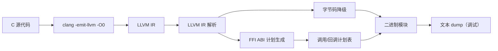
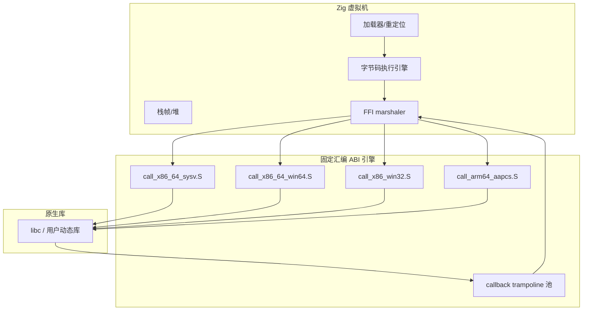

# C 解释器架构与关键决策

> 本文记录已实现的架构、决策、ABI 细节、已知边界、验证证据和范围外项。

## 1. 产品概述

实现一个完整的 C 语言解释器系统，包含 Zig 编译器前端和 Zig 运行时虚拟机。前端用 `zig cc`（Zig 捆绑的 clang）生成 LLVM IR，Zig lowerer 将其降为紧凑的栈式字节码，并为每个外部调用/callback 生成 ABI 计划；运行时用 Zig 实现字节码解释器，用**固定汇编 ABI 引擎**按计划完成原生调用和 callback，不链接 libffi，不使用 `@call` 桩矩阵，不申请动态可执行内存。Python 仅用于测试、fuzz、benchmark 和离线元数据生成，不再包含编译器实现。

设计目标：

- **产物小**：没有 256/struct 桩矩阵；FFI 引擎是每个 ABI 一段固定汇编 + Zig 侧计划解析。
- **C FFI 直接**：所有 VM 指针就是宿主指针，结构体布局与宿主 ABI 一致。
- **无动态可执行内存**：没有 JIT、没有 libffi closure、没有运行时代码生成；回调用静态 trampoline 池。
- **编译期决定 ABI**：前端知道所有签名，生成寄存器/栈位置、结构体分类、varargs 和 callback 反向计划；运行时只执行。
- **平台**：SysV x64、Win64、Win32、AArch64 AAPCS64 均已实现并通过真实环境交叉验证；ABI 计划按目标 ABI 生成。

## 2. 已确认决策

- **运行时语言**：Zig 0.13（pin）。
- **前端**：Zig + `zig cc` LLVM IR（`-O0`），typed AST parser + subset verifier；不使用 libclang/LLVM 进程内 API。
- **平台**：Linux x64、Windows x64、Windows x86、Linux ARM64 已实现；32 位仅 Windows x86，不做 Linux i386/ARM32。
- **C11 范围**：核心 C11 + 结构体 FFI。
- **FFI**：不链接 libffi，不使用 `@call` 桩矩阵，不申请动态可执行内存；编译期生成 FFI ABI 计划，运行时用固定汇编引擎执行；callback 用静态 trampoline 池 + 反向计划。
- **ABI 顺序**：Linux x64 → Windows x64 → Windows x86 → Linux ARM64（已完成）。
- **Callback 池**：固定 256 槽，SysV x86-64、Win64、Win32、AArch64 均已接入并通过交叉测试。槽位是**进程级一次性预算**：VM 销毁或 plan 重载后槽位永久退休、不再复用，单进程累计注册超过 256 个 callback 后返回 `TooManyCallbacks`（见 §12.3、§24）。
- **编译器发布方式**：仅构建期使用；发布物是 Zig 运行时 + 字节码。

## 3. 核心功能

### 3.1 编译器（Zig，build-time）

- **前端**：调用 `zig cc -S -emit-llvm -O0 -g0` 生成 LLVM IR，不依赖 Python 或外部 clang。
- **IR 生成**：`compiler/src/ir/` 解析为 typed AST，`lower_ast.zig` 将其降为基于栈的字节码。
- **FFI ABI 计划**：为每个外部调用/callback 生成寄存器/栈位置、结构体分类、varargs 信息和反向计划。
- **输出格式**：二进制字节码为主；文本格式仅用于调试 dump。
- **错误报告**：带源文件/行号的编译错误；不支持的 LLVM IR 模式明确报错。

### 3.2 运行时 VM（Zig）

- **字节码解释器**：栈式 VM，固定 8 字节栈槽。
- **动态符号链接**：Linux 用 `dlopen`/`dlsym`，Windows 用 `LoadLibraryA`/`GetProcAddress`。v2 包从 CIPI 按 plan 选择 provider 库/符号/别名，自动加载 CRT 或 Windows DLL；显式 `--lib` 优先覆盖，未收录的自定义符号仍走旧搜索。
- **FFI 桥接**：
  - Zig 侧按 ABI 计划把 VM 值搬进 `ABIFrame`（GPR/XMM/栈/sret）。
  - 每个 ABI 一段固定汇编引擎，负责装载寄存器/栈、调用目标、捕获返回值。
  - 回调用静态 trampoline 池捕获参数，Zig dispatcher 按反向计划调用 VM 函数；SysV/Win64/Win32/AArch64 均已接入。
  - 不链接 libffi，不使用 `@call` 桩，不产生动态可执行内存。
- **C ABI 导出**：运行时导出 `ci_vm_*` 纯 C ABI，可被 cffi、C/C++、其他语言直接调用。
- **跨平台**：Linux x64（SysV）、Windows x64、Windows x86、Linux ARM64（AArch64）由编译期 `ffi/platform.zig` 选择 frame/引擎/loader。

## 4. 技术栈与目标平台

### 4.1 编译器部分（Zig）

- **语言版本**：Zig 0.13（与运行时同一 pin）
- **C 前端**：`zig cc`（Zig 捆绑 clang 18），通过 subprocess 调用
- **实现**：typed IR lexer/parser/AST、subset verifier、CIVM lowering、CIPL/CIPM/CIPI writer
- **链接元数据**：构建期由 `compiler/tools/gen_link_index.zig` 从已安装 Zig 工具链生成 Windows（MinGW `.def`）与 Linux（glibc `abilists`）符号索引，二进制内嵌；保留的运行期 ABI 别名只有 `link_wrappers.json`。无 `--link-db`，无签入的 cstdapi/winmd 数据库（见 §23）。

不依赖 libclang/LLVM 进程内 API，也不依赖 Python 编译器包。

### 4.2 运行时部分（Zig + 汇编）

- **语言版本**：Zig 0.13（pin 具体版本；0.14 改了 `CallingConvention` 语法，暂不升级）
- **构建系统**：`zig build`；`.S` 文件由 clang 集成汇编器编译
- **平台 API**：
  - Linux：`std.DynLib` 或 `dlfcn.h`
  - Windows：`LoadLibraryA`/`GetProcAddress`（`ffi/native.zig`）
- **FFI**：编译期 ABI 计划 + 固定汇编引擎；不链接 libffi，不使用 `@call` 矩阵
- **无动态可执行内存**：无 JIT、无 closure、无运行时代码生成

### 4.3 ABI 支持矩阵

| ABI | 状态 | 说明 |
| --- | --- | --- |
| x86-64 System V | 已实现 | Linux x64；`call_x86_64_sysv.S` |
| x86-64 Microsoft | 已实现 | Windows x64；`call_x86_64_win64.S` |
| x86 Microsoft 32-bit | 已实现（cdecl + stdcall + fastcall） | Windows x86；`call_x86_win32.S`；`CIPL conv` 0=cdecl / 1=stdcall / 2=fastcall；`thiscall` 不支持 |
| AArch64 AAPCS64 | 已实现 | Linux ARM64；`call_arm64_aapcs.S`；x0-x7/v0-v7 |

## 5. 总体架构

### 5.1 编译器架构



### 5.2 运行时架构



## 6. 前端设计

### 6.1 clang LLVM IR

调用方式：

```bash
clang -S -emit-llvm -O0 -g -fno-discard-value-names -o program.ll program.c
```

选择 `-O0` 的原因：

- 局部变量以 `alloca` + `load`/`store` 形式存在，几乎没有 phi 节点，栈化接近 1:1。
- 不需要实现 mem2reg、SSA 构造、复杂优化 pass。
- 后续可选 `-O1`，但需要补 phi 处理，不作为 v1 必需项。

Zig 侧用 `compiler/src/ir/` 的 typed lexer/parser 解析文本 LLVM IR，并在 lowering 前执行 subset verifier。

支持的 LLVM IR 子集：

- 函数、基本块、全局变量、常量、字符串。
- 内存：`alloca`、`load`、`store`、`getelementptr`。
- 算术：`add`、`sub`、`mul`、`udiv`、`sdiv`、`urem`、`srem`、`fadd`、`fsub`、`fmul`、`fdiv`、`frem`。
- 位运算：`shl`、`lshr`、`ashr`、`and`、`or`、`xor`。
- 比较：`icmp`、`fcmp`（含谓词）。
- 转换：`trunc`、`zext`、`sext`、`fpext`、`fptrunc`、`fptosi`、`fptoui`、`sitofp`、`uitofp`、`ptrtoint`、`inttoptr`、`bitcast`；`x86_fp80` 为精确 f80（16B 存储），`fp128` 为精确 f128。
- 控制流：`ret`、`br`、`switch`、`select`、`phi`。
- 聚合：`extractvalue`；`insertvalue` 未支持。
- 调用：`call`（直接/间接/tail）；内部函数调用降为 VM `CALL`，外部声明降为 `CALL_NATIVE`/`CALL_VARARG`。
- 内建：`llvm.memcpy`、`llvm.memset`、`llvm.va_start/va_copy/va_end`、`llvm.stacksave/stackrestore`、`llvm.ptrmask`、`llvm.is.fpclass`、`llvm.fmuladd`、`llvm.fabs`/`sqrt`/`copysign` 等（完整清单见 [`docs/ir-subset.md`](./docs/ir-subset.md)）。

当前明确不支持（编译期报错）：可执行值中的向量类型、`insertvalue`、`extractelement`/`insertelement`/`shufflevector`、`freeze`、指令级 `va_arg`、atomic/`fence`、`invoke`/`resume`/`landingpad`、`indirectbr`/`callbr`、未知 intrinsic、内联汇编。子集契约以 [`docs/ir-subset.md`](./docs/ir-subset.md) 为准（本节早期版本曾把 phi、varargs、fptoui 等列为不支持，已被 §19.4/§21 的实现取代）。

降级规则：

- 每个 LLVM SSA 值映射到栈槽或临时栈项；`-O0` 下无需 phi 处理。
- `alloca` 分配当前函数帧槽位；`load`/`store` 生成带类型标签的 `LOAD`/`STORE`。
- `getelementptr` 优先折叠为常量字节偏移；不能折叠时生成 `PTR_ADD`。
- `icmp`/`fcmp` 生成 `CMP_*` + 谓词。
- `br` 生成 `JMP`/`JZ`/`JNZ`；`switch` 生成 `SWITCH`。
- `memcpy`/`memset` 生成 `MEMCPY`/`MEMSET`。
- `extractvalue` 生成字段偏移 load/store；聚合 store 使用 `MEMCPY`。
- 源位置从 `!dbg` 元数据提取，生成 `LINE_INFO`（可选）。

类型与布局：

- LLVM 类型直接映射：`i1/i8/i16/i32/i64`、`float`、`double`、`ptr`、数组、结构体。
- 结构体布局必须与 clang 的目标布局一致；前端根据 LLVM 结构体定义和目标对齐规则计算偏移，必要时用 `clang -Xclang -fdump-record-layouts` 交叉验证。
- 结构体赋值、union、bitfield、指定初始化器由 clang 降级为 load/store/shift/mask，前端不重复实现 C 语义。

### 6.2 字节码 IR 设计（基于栈）

采用栈式虚拟机，保持实现简单和字节码紧凑。

**设计原则**：

- 约 50 条通用 opcode + 1 字节类型标签，不按类型/位宽展开成 200 条。
- 同语义的有符号/无符号差异通过 opcode 或类型标签表达；加减乘不需要区分符号。
- 栈槽固定 8 字节；所有值按 8 字节槽存放，f32 存在低 32 位。
- 操作数使用 LEB128 变长编码；小立即数 1 字节。
- 所有指针是宿主指针，字符串 NUL 结尾，不做 handle 表或 moving GC。

**opcode 分类**（历史设计稿；实现增加了 `OP_CALL_VARIADIC_TYPED`、`OP_ALLOCA_DYN*`、`OP_STACKSAVE/OP_STACKRESTORE`、`OP_SETJMP/OP_LONGJMP`、`OP_VA_START/OP_VA_COPY`、`OP_FPCLASS` 以及 f80/f128 专用算术等。**当前唯一定义是 [`compiler/src/opcodes.zig`](./compiler/src/opcodes.zig)**，运行时同序号常量在 `runtime/src/vm.zig`；两者必须同步）：

1. **常量/局部变量**：`LOAD_CONST`、`LOAD_NULL`、`LOAD_LOCAL`、`STORE_LOCAL`、`LOAD_LOCAL_ADDR`、`LOAD_GLOBAL`、`STORE_GLOBAL`、`LOAD_GLOBAL_ADDR`。
2. **内存**：`LOAD`、`STORE`、`ALLOCA`、`MALLOC`、`FREE`、`REALLOC`、`MEMCPY`、`MEMSET`、`MEMMOVE`。
3. **整数算术**：`ADD`、`SUB`、`MUL`、`DIV_S`、`DIV_U`、`MOD_S`、`MOD_U`、`NEG`。
4. **浮点算术**：`FADD`、`FSUB`、`FMUL`、`FDIV`、`FREM`、`FNEG`。
5. **位运算**：`AND`、`OR`、`XOR`、`NOT`、`SHL`、`SHR_U`、`SHR_S`。
6. **比较**：`CMP_EQ`、`CMP_NE`、`CMP_LT`、`CMP_LE`、`CMP_GT`、`CMP_GE`；类型标签决定有符号/无符号/浮点。
7. **类型转换**：`EXT`、`TRUNC`、`ITOF`、`FTOI`、`F32_TO_F64`、`F64_TO_F32`、`PTR_TO_I64`、`I64_TO_PTR`。
8. **控制流**：`JMP`、`JZ`、`JNZ`、`SWITCH`、`CALL`、`CALL_INDIRECT`、`RET`、`RET_VOID`。
9. **指针/聚合**：`PTR_ADD`、`PTR_DIFF`、`GET_FIELD_PTR`、`GET_ELEM_PTR`。
10. **FFI**：`CALL_NATIVE`、`CALL_VARARG`、`DLOPEN`、`DLCLOSE`、`DLSYM`、`CREATE_CALLBACK`。
11. **杂项**：`NOP`、`POP`、`DUP`、`SWAP`、`LINE_INFO`、`BREAKPOINT`。

**类型标签**（1 字节）：

- `I8_S`、`I16_S`、`I32_S`、`I64_S`
- `I8_U`、`I16_U`、`I32_U`、`I64_U`
- `F32`、`F64`
- `PTR`、`VOID`

**编码格式**：

```text
[opcode:1][type_tag:1?][operand:LEB128?][operand2:LEB128?]
```

- 小立即数：1 字节；大立即数：LEB128。
- 跳转目标是字节码偏移（加载后重定位）。
- 二进制模块包含：magic/version/arch、常量池、字符串池、全局变量、函数表、字节码、FFI 计划表、行号表。

**栈帧**：

- 固定 8 字节槽；`local_count` 在加载时确定帧大小。
- `ALLOCA` 在 VM 栈上分配；`alloca` 动态大小也要支持。
- `CALL` 建立新帧；`RET` 恢复调用者帧。
- VM 必须可重入：native callback 可以再次进入 VM，帧和错误状态不能是全局单例。

### 6.3 FFI：编译期 ABI 计划

**核心思想**：

前端在编译 C 程序时已经知道每个外部调用/callback 的完整签名。它直接把这些信息编译成一份**ABI 计划**，说明每个参数/返回值在寄存器/栈/sret 中的位置。运行时不推断 C 类型，也不生成/选择 per-signature 代码，只按计划把值搬进 `ABIFrame`，然后调用固定汇编引擎。

这样：

- 没有 256 个 varargs 桩，也没有结构体桩矩阵。
- 不需要 per-program `.so` 或重新链接 runtime。
- 运行时是通用的；不同程序只带来不同的计划数据。
- 32 位 ABI 只是另一套计划生成规则 + 另一段汇编引擎。

**LLVM IR 已经做了 ABI lowering**：

- clang 会把小结构体参数 coerced 成 `i64`/`double`/literal aggregate；MEMORY 参数变成 `ptr byval(%struct.X)`；MEMORY 返回变成 `void + ptr sret(%struct.X)`。
- 因此前端生成器直接处理 lowered 类型/属性，不需要重新实现完整 C 结构体 ABI 分类；只需分类 clang 生成的 literal aggregate（如 `{ i32, double }`）以及处理 `byval`/`sret`。
- 这一点已由 `spike/callplan_gen` 端到端验证。

**计划内容**（类型定义**不再复制到本文**，避免再次漂移）：

- 编译器的计划/ABI 模型：[`compiler/src/abi.zig`](./compiler/src/abi.zig) 的 `Abi`、`Plan`、`ArgPlan`、`Loc`/`LocKind` 与 `buildPlanForAbi`；`plan.conv` 为 0=cdecl、1=stdcall、2=fastcall（仅 i686），`plan.ret_size`/`sse_count`/`sret`/`stack_size` 全量序列化到 CIPL v3。
- 运行时的解码后视图：[`runtime/src/ffi/abi.zig`](./runtime/src/ffi/abi.zig)；CIPL 解码在 [`runtime/src/ffi/plan_loader.zig`](./runtime/src/ffi/plan_loader.zig)。
- 二进制布局：[`docs/cib.md`](./docs/cib.md) 的 CIPL 章节。

> 早期草稿把 `Abi` 写成 `win32_cdecl`/`win32_stdcall` 两个枚举值、把 `LocKind` 写成带 `void_` 的枚举，并给 `CallPlan` 加了 `cleanup_bytes`/`is_varargs` 字段。当前实现改为单一 `win32` ABI + `conv` 字节（0/1/2），`LocKind` 为 `{ gpr, xmm, stack, sret, rax, rdx, xmm0, xmm1, xmm2, xmm3, st0 }`，varargs 由 `OP_CALL_VARARG*` 携带实参类型表，stdcall 清理量由 `plan.stack_size` 推导。这些差异以 `compiler/src/abi.zig` 为准。

- 前端为每个不同的调用签名生成并去重一个 `CallPlan`（`internPlan` 按完整内容去重：name、args/locs、ret_locs、stack/sret/sse/ret_size/conv）；`CALL_NATIVE`/`CALL_VARARG`/`CALL_INDIRECT_NATIVE` 携带计划 ID。
- 结构体参数按目标 ABI 拆成多个 `Loc`（例如 SysV 两个 eightbyte → 两个 GPR/XMM/栈位置）。
- 返回值：标量/浮点位置、结构体 multiple locations、sret 隐藏指针。
- varargs：计划包含实际变长参数的位置（clang IR 已经给出实际类型和默认提升）；SysV 的 `%al`、Win64 的浮点双写、Win32 的栈布局、ARM64 的 v0-v7/栈布局都在计划里。
- callback：生成反向计划，说明从哪些寄存器/栈位置读取参数、把返回值写回哪里、stdcall 的清理字节数。

**为什么不用 `@call`**：

- `@call` 需要 comptime 已知签名，导致 256/struct 桩矩阵。
- 固定汇编引擎 + 计划是数据驱动的：同一段汇编处理任意签名，计划由前端生成。
- 没有 per-signature 代码，也没有运行时动态代码。

### 6.4 Callback 反向计划

- 前端为每个 callback 签名生成反向计划（`emitCallback` 复用 `buildPlanForAbi`，`conv` 取被调函数定义的 cc：Win32 `__stdcall` callback → conv=1）。
- 运行时用固定 256 槽的静态 trampoline 池：
  - 每个 trampoline 把槽位号放进一个非参数寄存器（SysV 用 R11，Win32 用 EAX，ARM64 用 x16/x17），跳到公共入口。
  - 公共入口保存所有参数寄存器、XMM 和栈指针，调用 Zig `ci_callback_dispatch(slot, &frame)`。
  - dispatcher 按反向计划读取参数（上限 `plan_loader.MAX_ARGS`=64，不再有 8 参数截断），压入 VM 栈，执行 VM 函数，把返回值写回帧的返回寄存器/缓冲区。
  - 入口恢复返回值寄存器并 `ret`；Windows x86 的 `stdcall` callback 按 `plan.stack_size` 执行 `add esp, N`（`Win32CbFrame.cleanup`）。
- 纯静态代码；不需要 `ffi_closure`，不需要可执行内存。
- 槽位表固定 256 且**永久退休**：VM 销毁/plan 重载后 `callback_retired[slot]=true`，分配只找未退休的空槽，因此进程累计注册上限是 256，超出返回 `TooManyCallbacks`（不复用槽位，防止宿主保留的旧函数指针跳到新 VM）。
- v1 单线程：原生线程回调暂不支持；如需多线程，先加锁或每线程一个 VM。

## 7. 运行时设计

### 7.1 ABIFrame

Zig 侧为每个 ABI 定义固定布局的帧：

```zig
pub const SysV64Frame = extern struct {
    gpr: [6]u64,       // rdi, rsi, rdx, rcx, r8, r9
    xmm: [8][2]u64,    // xmm0..xmm7 的低/高位
    sse_count: u8,     // %al
    stack: [*]u8,      // 栈参数缓冲区
    stack_size: usize,
    sret: ?*anyopaque,
    ret_rax: u64,
    ret_rdx: u64,
    ret_xmm0: [2]u64,
    ret_xmm1: [2]u64,
};
```

- `ffi/platform.zig` 在编译期按目标选择 `SysVFrame` / `Win64Frame` / `Win32Frame` / `Arm64Frame`，并提供 `configure/marshal/readRet/invoke/validate` 分派。
- Win64 frame：`gpr[4]`、`xmm[4][2]`、`sse_count`、shadow/stack、sret、RAX/RDX/XMM0/XMM1 返回。
- Win32 frame：`eax`、`edx`、`st0`、stack、`stack_size`、`conv`、`ret_x87`。
- ARM64 frame：`gpr[8]`、`vec[8][2]`、`sret`(x8)、stack、`ret_x0/x1`、`ret_v0/v1`。
- `marshal` 按 `CallPlan` 把 VM 栈值拷贝到 GPR/XMM/vec/stack/sret；结构体按 `Loc` 拷贝字节，保持位模式。
- varargs 按计划填槽；SysV `%al`、Win64 浮点 GPR/XMM 副本、Win32 全栈。
- 返回值按 `ret_locs` 从帧的返回寄存器/缓冲区读取；Win32 i64 用单个 8B `rax` loc 合并 EAX:EDX，float 从 ST0 转 f32。

### 7.2 固定汇编引擎

每个 ABI 一段 `.S`：

```asm
// ci_abi_call_sysv64(frame: *SysV64Frame, target: *anyopaque)
ci_abi_call_sysv64:
    // 保存 callee-saved
    // 按 frame.stack_size 对齐 RSP 并拷贝栈参数
    // 装载 xmm0..xmm7、rdi..r9
    // mov al, [frame + sse_count]
    // call target
    // 保存 rax/rdx/xmm0/xmm1 到 frame
    // 恢复并返回
```

- 汇编只做固定 ABI 的寄存器/栈装载和返回值捕获，不解析复杂签名。
- 计划解析、结构体分类、varargs 位置已在 Zig/前端完成。
- 实际引擎符号：SysV `ci_abi_call_sysv64`、Win64 `ci_win64_call`、Win32 `ci_win32_call`（asm 标签 `_ci_win32_call`）、ARM64 `ci_arm64_call`。
- 二进制 `.cib`（CIPKG/CIVM/CIPL v3）的逐字段布局、opcode 表和示例见 [`docs/cib.md`](./docs/cib.md)。
- Win32 引擎处理 cdecl/stdcall 的栈参数与调用者清理、fastcall 的 ECX/EDX 参数、`eax/edx/st0` 返回值；`conv` 字节由 CIPL v3 携带（0/1/2），编译器已能生成 stdcall 与 fastcall 计划（§8.3、§20.2）。
- ARM64 引擎处理 x0–x7/v0–v7/栈参数，捕获 x0/x1 和 v0–v3 四个返回向量以及 x8 sret。
- Win64 引擎处理 32B shadow space、位置相关的 XMM 编号、sret 对 GPR/XMM 的移位和 varargs 浮点副本；保存 RSI/RDI 等 callee-saved 寄存器。
- 每个 ABI 一段固定代码，不随程序增长。

### 7.3 Marshaler

- 输入：VM 栈上的参数值、`CallPlan`、目标函数指针。
- 填充 `ABIFrame`：GPR/XMM/stack/sret。
- 调用固定汇编引擎。
- 按 `ret_locs` 读取返回值并写回 VM 栈。
- 不做运行时 C 类型推断；所有类型/位置来自计划。

### 7.4 Callback trampoline

见 6.4。要点：静态 256 槽、公共入口保存寄存器/栈、Zig dispatcher 按反向计划执行、stdcall 清理、可重入。

## 8. 调用约定

### 8.1 x86-64 System V（v1）

- 整数参数：RDI、RSI、RDX、RCX、R8、R9。
- 浮点参数：XMM0–XMM7。
- 变长参数：`%al` = 使用的 XMM 数量。
- 栈 16 字节对齐；调用者清理栈。
- 返回值：RAX/RDX 或 XMM0/XMM1；大结构体 sret。

### 8.2 x86-64 Microsoft（Windows x64）

- 整数参数：RCX、RDX、R8、R9；浮点参数：XMM0–XMM3。
- **寄存器编号按参数位置**：位置 i<4 的 double 用 XMMi，而不是独立浮点计数器（例如 `f(int,double,int,double)` → RCX/XMM1/R8/XMM3）。
- sret 隐藏指针占用第 0 个位置，普通参数从位置 1 开始；GPR 和 XMM 两个寄存器文件都整体后移一位。
- 32 字节 shadow space；栈 16 字节对齐；超过 4 个位置用栈。
- varargs：浮点值在对应位置 XMM、GPR 及栈 home 位置按计划复制；`sse_count` 写 AL。
- 返回值：RAX/XMM0；>8B 结构体 sret；1/2/4/8B 结构体按整数返回。
- 引擎必须保存 RSI/RDI/ RBX/R12–R15 等 Windows callee-saved 寄存器。

### 8.3 Windows x86（32 位）

- **调用约定**：编译器按 `x86_stdcallcc` → `conv=1`、`x86_fastcallcc` → `conv=2` 生成计划（调用点优先，声明为回退；已知 WinAPI 导出仍由 `win_defs` 覆盖），`thiscall` 不支持。2026-10-31 的早期状态是“只生成 cdecl 计划”，已被 §19.3/§20.2 的 stdcall 与 fastcall 实现取代。
- cdecl/stdcall 的所有参数在栈上，4 字节对齐；fastcall 的前两个 4 字节标量走 ECX/EDX，其余在栈上；byval 结构体按原始字节复制到栈。
- 返回值：≤4B 用 EAX；i64 合并为一个 8B `rax` loc（EAX:EDX）；float/double 在 ST0（`ret_x87` 标志），float 读取时转 f32；小结构体 EAX:EDX；大结构体 sret 隐藏指针在栈首。
- 保存 EBX/ESI/EDI/EBP；引擎在恢复前必须丢弃临时 target/conv 槽（已修复一个栈清理 bug）。
- `fastcall` 原生/间接调用已支持（ECX/EDX + 栈，`examples/ffi_fastcall.c`）；`fastcall` callback 与 `thiscall` 不在支持范围（§24）。

### 8.4 AArch64 AAPCS64（Linux ARM64）

- 整数/指针参数：x0–x7；浮点/向量参数：v0–v7；栈 16 字节对齐。
- 返回值：x0/x1 或 v0–v3；大结构体 sret 指针在 x8。
- HFA（1–4 个同类型 float/double）：参数/返回用连续 v 寄存器；聚合整体存储为 16B 时通过 aggregate store/memcpy 复制。
- 当前状态：HFA 3/4 成员、栈上 HFA、HFA callback 4 向量和 fp128/`long double` callback 已覆盖（§20.5）。早期“HFA 返回最多 2 个向量、3/4 成员与栈上 HFA 未做”的记录已过时。

## 9. 变长参数

- 前端从 LLVM IR 的 `call` 指令直接获得每个实参的类型（clang 已完成默认实参提升：`float` → `double`，小整数 → `int`）。
- 前端把实际变长参数也生成 `Loc`：SysV 填 GPR/XMM/栈，并计算 `%al`；Win64 计算浮点的 GPR 副本；Win32 计算栈/ECX/EDX 位置；ARM64 计算 x0–x7/v0–v7/栈位置。
- 运行时按计划填 `ABIFrame`；没有 8 槽 padding、没有 mask 矩阵、没有 256 个桩。
- v1 支持 printf/snprintf 以及任意变长函数调用，只要参数类型在支持范围内；变长参数里的 struct/`long double` 现已支持（`OP_CALL_VARIADIC_TYPED` 携带每个额外参数的 layout code，见 §20.12）。
- 定义变长参数函数（`va_start`/`va_arg`/`va_end`/`va_copy`）已支持，四个 ABI 均覆盖（VM 内 va_list，见 §20.2/§19.4）。早期“v1 不支持”的记录已过时。

## 10. 结构体 FFI

- clang 已经在 LLVM IR 里完成大部分结构体 ABI lowering：
  - 小结构体参数 → coerced `i64`/`double`/literal aggregate。
  - MEMORY 参数 → `ptr byval(%struct.X)`。
  - MEMORY 返回 → `void + ptr sret(%struct.X)`。
- 前端生成器主要处理 lowered 类型：
  - literal aggregate 按字段/8 字节分类为 GPR/XMM。
  - `byval` 直接按栈结构体（pointee size/align）。
  - `sret` 直接按隐藏指针 + 返回缓冲区。
- Win64/Win32/ARM64 的 clang lowered IR 同样会给出 byval/sret/coerced 形式；生成器按目标 ABI 的 lowered 规则处理。
- [`runtime/src/ffi/platform.zig`](./runtime/src/ffi/platform.zig) 的 `marshal` 按 `Loc` 拷贝结构体字节到寄存器/栈或从返回值位置拷回；不做类型转换（原 `marshal.zig` 已合并进该文件）。
- 仍需用 clang 编译的 C helper 做对照测试，覆盖 literal aggregate、未对齐/packed、栈参数边界。
- 没有代表类型矩阵；计划里直接是位置和字节数。

## 11. 目录结构

以下为仓库中**实际存在**的文件（2026-11-03 核对；不再列出已删除的 `c_api.zig`/`value.zig`/`opcodes.zig`(runtime)/`execute.zig`/`loader.zig`/`memory.zig`/`platform/` 子目录，也不再把 `examples/ffi_demo.c`、`qsort_demo.c` 当作现有文件）：

```text
cl/
├── compiler/                          # Zig 编译器（build-time）
│   ├── build.zig                      # 构建期运行 gen_link_index，生成 win_defs/libc_defs
│   ├── src/
│   │   ├── main.zig                   # CLI、CIPKG/CIPM/CIPI writer、validateLimits
│   │   ├── opcodes.zig                # CIVM opcode 的唯一定义
│   │   ├── abi.zig                    # Plan/ArgPlan/Loc、buildPlanForAbi、convFromName
│   │   ├── lower_ast.zig              # AST -> CIVM lowering、internPlan 去重、callback 计划
│   │   ├── imports.zig                # CIPI 结构与序列化
│   │   ├── link_index.zig             # 构建期符号索引的二进制格式
│   │   ├── win_defs.zig               # Windows provider（Zig 自带 MinGW .def）
│   │   ├── libc_defs.zig              # Linux provider（Zig 自带 glibc abilists）
│   │   ├── link_wrappers.zig          # target 级 ABI 别名（snprintf -> _snprintf）
│   │   ├── data/link_wrappers.json    # 唯一保留的签入链接元数据
│   │   ├── ir/                        # lexer.zig、ast.zig、parser.zig、verify.zig、dump.zig、tests.zig
│   │   └── testdata/lower_ast/        # lowering fixtures + golden/*.golden
│   └── tools/gen_link_index.zig       # MinGW defs -> win_defs / glibc abilists -> libc_defs
│
├── runtime/                           # Zig 运行时（shipped）
│   ├── build.zig                      # 可执行文件 + static/shared 库 + 头文件安装
│   ├── build.zig.zon
│   ├── include/cinterp.h              # 公开 C ABI（ABI 2）
│   ├── src/
│   │   ├── main.zig                   # cinterp-run CLI
│   │   ├── vm.zig                     # VM、线性内存、C ABI、callback dispatcher
│   │   ├── vm_test.zig                # 运行时单测
│   │   └── ffi/
│   │       ├── abi.zig                # LocKind/Loc/ArgPlan/CallPlan（loader 与引擎共用）
│   │       ├── plan_loader.zig        # CIPL 解码与 plan store
│   │       ├── link_loader.zig        # CIPM/CIPI 解析与目标/import 校验
│   │       ├── native.zig             # dlopen/LoadLibrary 符号解析
│   │       ├── platform.zig           # 编译期 ABI 选择、frame、marshal、invoke、validate
│   │       └── asm/
│   │           ├── call_x86_64_sysv.S
│   │           ├── call_x86_64_win64.S
│   │           ├── call_x86_win32.S           # cdecl/stdcall/fastcall
│   │           ├── call_arm64_aapcs.S
│   │           ├── callbacks_x86_64_sysv.S
│   │           ├── callbacks_x86_64_win64.S
│   │           ├── callbacks_x86_win32.S
│   │           └── callbacks_arm64_aapcs.S
│   └── tests/                         # capi_smoke.c、capi_argv.c、capi_fuzz.c
│
├── examples/                          # hello.c、arrays.c、structs.c、ffi_*.c、bitfields.c、
│                                      # longdouble.c、math.c ……（无 ffi_demo.c / qsort_demo.c）
├── docs/                              # cib.md、embedding.md、compatibility.md、ir-subset.md、
│                                      # ir-parser-differences.md、zig-frontend.md
├── packaging/                         # cinterp.pc.in、cmake/、rust/cinterp-sys、README.release.md.in
├── scripts/                           # test/fuzz/differential/release harness（Python）
├── tests/                             # csuite/（17 例）、manifests/、generator-known-failures.json
├── spike/                             # 可行性验证（gitignored，非最终产物）
└── README.md、dev.md、Makefile、VERSION、LICENSE
```

> **当前实现（2026-11-03 更新）**：Zig 编译器 `compiler/` 是唯一编译器；Python 编译器已删除。当前编译器/运行时支持 SysV x64、Win64、Win32 与 AArch64 AAPCS64：标量/控制流、线性内存、globals/字符串、float32/double、bitfield、标量/指针/varargs FFI、external data provider、MEMORY/register/mixed/HFA struct、Win64/Win32 sret/byval、Win32 stdcall/fastcall、AArch64 HFA 3/4 与栈 HFA；callback trampoline 覆盖全部四种 ABI（Win32 stdcall 会按 `stack_size` 清理栈，fastcall callback 不支持）。`long double` 使用 x86 f80 / AArch64 f128 精确表示并接入 FFI/printf；上游 c-testsuite 在 manifest 下为 218/2（独立脚本默认 217/3，见 §14）；fuzz/CI/自动链接已接入。

## 12. 关键代码结构

### 12.1 值表示与 opcode（Zig）

代码不再复制到本文，单一来源如下：

- 值表示：`runtime/src/vm.zig` 的 `Value`（`extern union { i: i64, u: u64 }`；浮点按位存放在 `u`，f32 只在低 32 位有效，f80/f128 经线性内存按指针传递）。
- opcode：**唯一**定义是 [`compiler/src/opcodes.zig`](./compiler/src/opcodes.zig)（`OP_*: u8` 常量，0x01–0xA2，含 f80/f128 专用算术、`OP_CALL_VARIADIC_TYPED`、`OP_SETJMP/OP_LONGJMP`、`OP_VA_START/OP_VA_COPY`、`OP_ALLOCA_DYN*`、`OP_STACKSAVE/OP_STACKRESTORE`、`OP_FPCLASS` 等）；运行时同序号常量在 `runtime/src/vm.zig`，两者必须同步。
- 早期文档里的 `OpCode` enum 与 `load_const`/`ptr_add` 等命名已不存在（运行时按 LLVM 类型标签 + 具体 opcode 展开），不再保留代码块以避免再次漂移。

### 12.2 FFI 计划类型（Zig）

同样以代码为单一来源：

- 编译器侧：[`compiler/src/abi.zig`](./compiler/src/abi.zig) 的 `Plan`/`ArgPlan`/`Loc`；`Plan` 字段为 `name`、`args`、`ret_locs`、`stack_size`、`sret`、`sse_count`、`ret_size`、`conv`（无 `cleanup_bytes`/`is_varargs`）。
- 运行时侧：[`runtime/src/ffi/abi.zig`](./runtime/src/ffi/abi.zig) 的 `LocKind = { gpr, xmm, stack, sret, rax, rdx, xmm0, xmm1, st0, xmm2, xmm3 }`、`Loc`、`ArgPlan`、`CallPlan`（字段 `args`、`ret_locs`、`stack_size`、`stack_align`、`sret`、`sse_count`、`ret_size`、`conv`）。
- stdcall 清理量由 `plan.stack_size` 推导，varargs 由 `OP_CALL_VARARG*` 携带实参类型表；CIPL 二进制布局见 [`docs/cib.md`](./docs/cib.md)，解码在 `runtime/src/ffi/plan_loader.zig`。

### 12.3 VM C ABI

公开头文件为 `runtime/include/cinterp.h`，`zig build` 同时安装 `libcinterp.a`、`libcinterp.so`（Windows 为 `cinterp_static.lib`/`cinterp.lib`/`cinterp.dll`）和头文件。C ABI 版本为 **2**（`CI_ABI_VERSION`，运行时可查 `ci_abi_version()`）。

```c
ci_vm *ci_vm_create(size_t stack_size);
ci_vm *ci_vm_create_ex(const ci_vm_config *config);
void ci_vm_destroy(ci_vm *vm);
int ci_vm_load_module(ci_vm *, const uint8_t *, size_t);
int ci_vm_load_plans(ci_vm *, const uint8_t *, size_t);
int ci_vm_load_package(ci_vm *, const uint8_t *, size_t);
int ci_vm_load_library(ci_vm *, const char *);
int ci_vm_run(ci_vm *, const char *entry);
int ci_vm_run_args(ci_vm *, const char *entry, int argc, const char *const *argv);
int64_t ci_vm_result(const ci_vm *);
const char *ci_vm_last_error(const ci_vm *);
int ci_vm_last_error_code(const ci_vm *);
int ci_vm_clear_error(ci_vm *vm);
int ci_abi_version(void);
const char *ci_version(void);
```

返回 `int` 的接口成功时返回 `CI_OK`（0），失败时返回负的 `CI_E_*` 类别码（`CI_ERROR`=-1 仅用于无法归类的失败）；同一类别也可用 `ci_vm_last_error_code()` 读取，`ci_vm_last_error()` 返回消息，`ci_vm_clear_error()` 同时清除两者。`ci_vm_run`/`ci_vm_run_args` 返回状态码而非 C `main` 返回值；返回值通过 `ci_vm_result` 获取。loader 是事务性的，失败不会替换已加载包。callback 注册表按 VM 隔离，进程级 trampoline 槽在 VM 销毁/重载 plan 后永久退休（见 §6.4、§24）；同一 VM 仍要求单线程调用。

### 12.4 固定汇编调用引擎（示意）

```asm
// runtime/src/ffi/asm/call_x86_64_sysv.S
// ci_abi_call_sysv64(frame: *SysV64Frame, target: *anyopaque)
ci_abi_call_sysv64:
    push rbp
    mov rbp, rsp
    push rbx
    push r12
    push r13
    push r14
    push r15

    // frame in rdi, target in rsi
    // 对齐/拷贝栈参数（frame.stack -> rsp）
    // 装载 xmm0-7
    // 装载 rdi, rsi, rdx, rcx, r8, r9
    // mov al, [frame].sse_count
    call rsi

    // 保存 rax/rdx/xmm0/xmm1 到 frame
    pop r15
    pop r14
    pop r13
    pop r12
    pop rbx
    leave
    ret
```

### 12.5 Callback trampoline（示意）

```asm
// callbacks_x86_64_sysv.S
ci_cb_sysv_0:
    mov r11d, 0
    jmp ci_cb_sysv_entry
ci_cb_sysv_1:
    mov r11d, 1
    jmp ci_cb_sysv_entry
// ... 256 槽

ci_cb_sysv_entry:
    // 保存 GPR/XMM/RSP 到回调帧
    // rdi = slot, rsi = frame
    call ci_callback_dispatch
    // 从帧装载返回值寄存器
    ret
```

### 12.6 计划模型的唯一实现

`compiler/src/abi.zig` 的 `Loc`/`ArgPlan`/`Plan` 是唯一计划模型；`main.zig` 将其序列化为 CIPL，`lower_ast.zig` 通过 `buildPlanForAbi` 构造计划。原 Python 计划模型已随 Python 编译器删除，不再有第二份实现。

## 13. 体积、性能与错误处理

### 13.1 体积

- 没有 256/struct 矩阵；x86-64 SysV 引擎 spike 的 `ReleaseSmall` 为 8.7K（text 5,586），每个 ABI 的引擎是固定代码。
- callback trampoline 池 256 槽，每槽几条指令，几 KB 量级。
- FFI 计划是 per-program 数据；`spike/callplan_gen` 的 15 个计划 + harness `ReleaseSmall` 8.7K（text 5,591）。
- `ReleaseSmall` + strip；仅编译宿主 ABI。
- 建议运行时目标：动态链接 libc 时 < 150KB（含一个 ABI 引擎 + trampoline 池）；实测为准。
- `dlopen` 基本要求动态链接 libc（静态 musl 下 dlopen 不可用/受限）。

### 13.2 性能

- 解释循环先用 `switch`；加载时预解码字节码。
- FFI marshaler 只做字节拷贝/槽位填充，不做运行时类型推断。
- 原生符号按需解析、按 plan 缓存：直接 `CALL_NATIVE`/`CALL_VARARG` 在**首次调用**时解析目标，并把解析结果按 plan index 缓存在 `native_plan_cache`（`runtime/src/vm.zig` 的 `resolvedNative`）；CIPI provider 句柄按 import 槽位缓存（`import_handles`）。
- 缓存失效规则：plan store 重载/包替换清空 provider 句柄、原生 target 注册和计划目标缓存（`resetResolverCaches`），新增 `--lib` 只清空计划目标缓存（`clearNativeCache`）；显式 `--lib` 句柄本身保存在 `libraries` 中，跨 plan/包重载保留（`loadPackageInPlace` 的注释）。
- 原生 target 注册表上限 256，超出返回 `TooManyNativeTargets`（不再静默丢弃）。
- 回调 dispatcher 只做计划驱动的参数搬运。
- 栈槽固定 8 字节。

### 13.3 错误处理

- 前端：Zig 错误 + `line:column` 诊断；不支持的 LLVM IR/ABI 模式明确报错。
- 运行时：错误码 + 错误字符串缓冲区；不跨 native 栈展开。
- FFI 计划缺失/ABI 不匹配：加载期或调用期报错，不做运行时猜测。
- `dlopen`/`dlsym` 失败保留 `dlerror` 文本。

## 14. 测试策略

当前测试入口：

```bash
make test            # runtime 单测（20）+ compiler 单测（98 个 test 块）+ 端到端用例 + 错误路径
make c-testsuite     # 本地 C 子集（17/17）
python3 scripts/c_testsuite_upstream.py  # 上游支持集：独立脚本默认 217/217 + 3 skip（manifest 为 218/2，见下）
make fuzz            # load-only package/plan 变异（1000）
make fuzz-exec       # 字节码执行 fuzz（500 变异 0 crash）
make fuzz-bytecode   # 结构化 CIVM 变异（500）
make lint            # civm_lint.py 校验 CIPKG/CIVM/CIPL 结构
make evidence        # test/lint/size/test-suites-smoke/differential + check_plan_evidence.py
make check-version   # VERSION 与 runtime/build.zig.zon、Rust crate、SBOM 一致性
make differential    # clang 原生 vs cinterp-cc 返回值差分
make bench           # 每用例平均运行时间
make size-cross      # 四个目标 ReleaseSmall 体积
make release-artifacts
HOST=user@windows ./scripts/test_cross.sh   # 62 个跨 ABI 用例（Win64 20 / Win32 23 / ARM64 19）
```

> `make evidence` 与 `make check-version` 由本轮新增：前者串联 `test lint size test-suites-smoke differential` 后运行 `scripts/check_plan_evidence.py`，后者校验版本一致性。

测试分层：

- 前端单测：`compiler` 的 LLVM IR 解析、AST/verifier、降级、ABI 计划、二进制 round-trip（`cd compiler && zig build test`，当前 `compiler/src/**` 共 98 个 `test` 块，分 9 个测试二进制）。
- 运行时单测：CIVM、栈/帧、内存/计划校验、错误路径、callback 槽退休（`runtime/src/vm_test.zig` 13 个 + `runtime/src/ffi/platform.zig` 7 个 ABI/计划校验单测，共 20）。
- 端到端：hello/arrays/structs/malloc/puts/printf/snprintf、float/double/long double、struct FFI、HFA、packed、qsort/callback、ABI 边界。
- 交叉矩阵：`scripts/test_cross.sh` 当前 62 个用例（Win64 20、Win32 23 含 stdcall/fastcall/callback_stdcall/winapi、ARM64 19）；Wine/真实 Windows SSH + qemu。
- c-testsuite：本地 17/17；上游 manifest（`tests/manifests/c-testsuite.json`）为 218/218 + 2 skip（`00204` 向量、`00216` 复杂聚合全局初始化）；独立脚本 `scripts/c_testsuite_upstream.py` 仍默认旧的 `tests/csuite/cinterp.skip`，多列一个已可运行的 `00189`（外部数据符号），因此报 217/217 + 3 skip。两份 skip 清单尚未统一：manifest 运行报 218/2，独立脚本报 217/3，引用时需注明来源。
- fuzz：load-only package/plan + bytecode 执行；差分测试覆盖无外部依赖用例。

## 15. 当前边界与明确不支持

- **平台**：Linux x64、Windows x64、Windows x86、Linux ARM64 已支持；Linux i386/ARM32、macOS、Windows ARM64 不在目标。
- **C11**：`_Atomic`、`_Thread_local`、`_Complex`、内联汇编、向量类型、`indirectbr` 不支持；`_Generic`、`_Static_assert`、`_Alignas/_Alignof`、VLA、`setjmp/longjmp`、static inline 已支持（仅保证 clang `-O0` IR）。
- **long double**：x86 使用精确 f80，AArch64 使用 IEEE f128；FFI/varargs 已接入；Windows CRT `%Lf` 与原生 MinGW 输出一致（原生本身不支持该格式）。
- **变长参数**：内部/外部 varargs、`va_start`/`va_arg`/`va_end`/`va_copy` 已支持；struct/`long double` varargs 仍有边界限制。
- **callback**：SysV/Win64/Win32/AArch64 静态 trampoline 已接入；HFA 参数/返回、long double ST0、sret/byval 聚合已覆盖；Windows HFA 专用 helper 未做远端值域回归。
- **Win32**：cdecl/stdcall/fastcall 已接入；`thiscall` 不支持。
- **AAPCS64**：HFA 3/4、栈 HFA、HFA callback 4 向量和 fp128/long double callback 已覆盖；少数大结构体组合仍需分诊。
- **SysV**：packed/未对齐、MEMORY/sret、mixed aggregate 已覆盖；>2 eightbyte 非 MEMORY 聚合、i128、向量类型未纳入。
- **外部数据符号**：`stdout`/`errno`/`environ`/`stdin`/`tzname`/`opt*` 等已解析，Windows UCRT helper 也接入；更冷门的数据符号仍按 provider/fallback 处理。
- **工具链/信任**：`zig cc -O0`；VM 指针就是宿主指针，运行时提供安全的 CIB 信任模型，不提供进程内沙箱或 Safe 模式。不可信输入由宿主自行隔离。

## 16. 剩余风险与后续方向

- **外部数据符号**：基础 data provider 已完成；剩余为非常见 libc/平台全局，遇未解析符号时按显式 skip 记录。
- **向量/复杂 ABI**：Win64 `__vectorcall`/COM、Win32 `thiscall`、SysV i128/vector 仍是明确范围外。
- **long double**：Windows CRT 限制是宿主运行时问题；如需精确 `%Lf`，需提供自有格式化 shim。
- **跨 ABI 执行 fuzz**：当前 bytecode fuzz 在 native 运行时；其他 ABI 需要对应运行时/Windows/qemu 上的 fuzz 流程。
- **CI 外部环境**：Windows/ARM64 CI 使用托管 runner 的 smoke；完整 Windows SSH/qemu 矩阵仍需自托管环境。
- **发布**：已生成四目标 tarball；许可证/正式发布渠道仍需项目方确认。

## 17. 验证结论（关键发现，历史 spike 记录）

> 以下是 2026-10-30 的 spike 结论，保留作 ABI/路线参考；当前实现状态、修复和剩余边界见第 19 节。

- **clang IR 已完成大部分结构体 ABI lowering**：小结构体参数 coerced 成 `i64`/`double`/literal aggregate；MEMORY 参数是 `ptr byval(...)`；MEMORY 返回是 `sret`。因此前端计划生成器不需要重新实现完整 C 结构体 ABI 分类，只需处理 lowered 类型和 literal aggregate。
- **固定汇编引擎可行**：`spike/asm_abi_call` 用一段固定 x86-64 SysV 汇编 + 手写 `CallPlan` 通过标量、混合、结构体、`byval`、`sret`、varargs 测试；`ReleaseSmall` 8.7K。
- **前端计划生成可行**：`spike/callplan_gen` 从 clang IR 生成 15 个计划并驱动同一个引擎，4/4 通过；不需要 256/struct 桩矩阵。
- **计划二进制表可行**：15 个计划编码为 995 字节，Zig loader 通过 round-trip、名称查找、解码后调用和错误路径测试（S4，6/6）。
- **最小 VM 核心可行**：`CIVM` v1 模块、栈/帧/opcode 循环和 `ci_vm_*` C ABI 通过 `return 42`、算术、循环、内部调用和 loader 错误测试（S5，6/6，17K）。
- **VM FFI 集成可行**：VM 通过 `CALL_NATIVE`/`CALL_VARARG`/`CALL_INDIRECT` 调用标量、结构体、`sret`、varargs，并通过 `dlopen`/`dlsym` 调用 libc（S7，2/2，37K）。
- **Callback trampoline 可行**：256 槽静态 trampoline + 反向计划，qsort 和结构体参数/返回 callback 执行真实 VM 函数，无动态可执行内存（S8，3/3，20K）。
- **LLVM IR 降级可行**：从 clang `-O0` IR 生成 `CIVM`，标量/控制流、整数语义、线性内存数组/结构体/指针、union、memcpy/memset、globals/字符串均通过（S6+S9，12/12，21K）。
- **Win64 ABI 可行**：固定引擎 + 计划在 Windows x64 测试机通过 GPR/栈、混合 int/double、小/大结构体、sret、varargs（S10，6/6，34K PE）。
- **Win32 ABI 引擎可行**：C harness 6/6；Zig 连续/每进程 6/6 且 exit 0；之前的崩溃在 harness 的 `argsFree`，引擎/C shim 本身稳定（S11，6/6）。
- **ARM64 AAPCS64 可行**：qemu-aarch64 下通过整数、混合、HFA、栈参数、sret（S12，6/6，12K）。
- **C11 内存/全局模型可行**：VM 线性内存 + ALLOCA/LOAD_MEM/STORE_MEM + GEP；数组、结构体、指针、union、memcpy/memset、globals/字符串通过（S9 部分，sample1..12 12/12，21K）；bitfield/float/c-testsuite 待扩展。
- **`@call` 矩阵已放弃**：早期 `ffi_struct_call`/`varargs_call` spike 保留为 ABI 行为参考；256 桩矩阵（63K/固定前缀）不再采用。
- 各 spike 的目标/结果保留在 `spike/*/README.md`；当前实现状态与验证证据见第 19 节。

## 18. 参考实现

- chibicc / c-testsuite：C 测试用例和编译器结构参考。
- LLVM IR 指令语义和 clang `-O0` 输出模式。
- System V AMD64、Microsoft x64/x86 调用约定、AArch64 AAPCS64。
- libffi / dyncall：ABI 分类和栈布局实现参考（不引入依赖）。

## 19. 2026-10-31 实现更新（多 ABI 与数值/测试）

### 19.1 编译器

- `cinterp compile --target` 支持：
  - `x86_64-linux` → clang triple `x86_64-pc-linux-gnu`，ABI `sysv`，指针 8B。
  - `x86_64-windows` → `x86_64-pc-windows-gnu`，ABI `win64`，指针 8B。
  - `i686-windows` → `i686-pc-windows-gnu`，ABI `win32`，指针 4B。
  - `aarch64-linux` → `aarch64-linux-gnu`，ABI `aapcs64`，指针 8B。
- `ffi/plan.py` 的 `build_plan()` 按 ABI 分派到 `build_sysv_plan` / `build_win64_plan` / `build_win32_plan` / `build_aapcs64_plan`；CIPL v3 头部的 ABI id 分别为 1/2/3/4，运行时加载时校验。
- 目标指针大小贯穿 `type_size_align`、`struct_layout`、globals、GEP、alloca/load/store；Win32 结构体布局按 4B 指针计算。
- 聚合值表示：>8B 的 load 结果保存“指向源字节的指针”；聚合 store 用 `MEMCPY`；ARM64 `[2 x i64]`/`%struct.D2` 返回值经 `extractvalue`/指针读取。
- 新增 `select` 降级为分支；bitfield 依赖 clang 的 shift/mask lowering；`long double` 走 16B 存储/64-bit 精度路径。
- `CallbackTable` 也会为目标 ABI 生成 callback 计划。当天（2026-10-31）运行时只支持 SysV callback；**现已覆盖全部四个 ABI**（SysV x64、Win64、Win32 cdecl/stdcall、AArch64），Win32 `__fastcall` callback 在注册/调用前返回 `UnsupportedCallback`（`runtime/src/ffi/platform.zig` 的 `win32CallbackSupported`，见 §6.4、§24）。

### 19.2 运行时

- `src/ffi/platform.zig` 编译期选择 ABI、Frame、marshal/readRet/invoke/validate、callback 表；`src/ffi/native.zig` 统一 Unix `dlopen/dlsym` 与 Windows `LoadLibraryA/GetProcAddress`。
- `build.zig` 按 target 只链接对应引擎：SysV + callback 池、Win64、Win32 或 ARM64。
- `invokeFfi` 现在只写 `loc.size` 字节（不再固定写 8B），避免 Win32 紧凑栈 arg block 被相邻参数覆盖。
- `OP_ADDR_CONST`/`OP_ALLOCA`/ret_buf 的宿主指针统一经 `usize` 转换，支持 32 位运行时。
- `--load-only` 只加载/校验 CIPKG，不执行字节码；`make fuzz` 用它做 package/plan 变异测试。
- 计划校验覆盖 ABI loc 索引、offset/size、stack/sret/ret_size/sse_count；损坏计划在调用前失败。

### 19.3 ABI 决策与已修复问题

- **Win64**
  - 整数/浮点寄存器编号都按**参数位置**（RCX/RDX/R8/R9 与 XMM0–3），不是独立计数器；`f(int,double,int,double)` 使用 RCX/XMM1/R8/XMM3。
  - sret 隐藏指针占参数位置 0，显式参数从位置 1 开始，GPR/XMM 两个寄存器文件都后移。
  - varargs 浮点按计划同时写位置 XMM、GPR 副本和栈 home；`sse_count` 写 AL。
  - 引擎必须保存 RSI/RDI；此前未保存导致 ReleaseSmall/ReleaseSafe 原生调用崩溃，已修复。
- **Win32**
  - 所有参数在栈上，4B 对齐；byval 结构体复制原始字节；sret 隐藏指针在栈首。
  - i64 返回值合并为单个 8B `rax` ret loc（EAX:EDX）；否则 VM 会把 ret_locs>1 误判为聚合指针。
  - float 从 ST0 读取后转换为 f32；double 直接读 8B；`ret_x87` 由计划自动设置。
  - （历史，2026-10-31）当时编译器可按 `CIPL conv` 生成 cdecl 或 stdcall 计划，stdcall 已通过真实 Win32 测试。`conv=2`（`x86_fastcallcc`）已随后接入直接调用、间接调用和 callback 计划（`convFromName`/`plan.conv`，见 §8.3、§20.2）。
  - 修复引擎恢复前未丢弃 target/conv 两个临时栈槽的问题；该 bug 在优化构建中破坏 EBX/ESI/EDI。
- **AAPCS64**
  - （历史，2026-10-31）当时 HFA 参数/≤2 向量返回走 v0/v1；`[2 x double]` 参数、`%struct.D2` 返回、16B 聚合 store 已覆盖。HFA 3/4 成员、栈上 HFA 与 4 个返回向量已在后续补齐，见 §20.5；当前边界见 §8.4/§15。
  - 大结构体通过指针/sret；x8 保存 sret；栈 16B 对齐。
- **SysV**
  - 既有 SysV 行为保持；callback trampoline 覆盖 SysV/Win64/Win32/AArch64。
- **Windows 符号解析**
  - `--lib` 加载的 DLL 也会参与 `GetProcAddress` 搜索，再回退到 msvcrt/ucrtbase；`snprintf` 在 Windows 上回退到 `_snprintf`。
  - helper DLL 用 `zig cc -shared -Wl,--export-all-symbols` 导出符号。

### 19.4 数值与 C 子集

- float32/double：`fadd/fsub/fmul/fdiv`、`fcmp`、`fpext/fptrunc`、`sitofp/fptosi`，含 FFI float 参数/返回。
- long double：x86 `f80`/AArch64 `f128` 指针值表示，VM 精确算术/比较/转换；`st0` loc、SysV/Win32 x87 捕获；FFI/varargs printf 已接入。
- bitfield、`select`、phi、VLA、内部函数指针/间接调用、packed struct、global pointer/function reloc 已接入。
- 本地 c-testsuite **17/17**；上游支持集在 manifest 下为 **218/218 + 2 skip**，独立脚本 `scripts/c_testsuite_upstream.py` 仍默认旧的 `tests/csuite/cinterp.skip`，报 **217/217 + 3 skip**（差异见 §14）。

### 19.5 验证矩阵与命令

> **历史证据（2026-10-31 当时状态）**：下表与随后的命令是当天的记录，数字保留原样，**不代表当前基线**（单测数、cross 用例数、c-testsuite 数量和小体积数字此后均已变化）。
> 当前数字见 §20.24、§21.3 与 §14：full 4319/4521（202 skip）、standard 396/495（99 skip）、本地 c-testsuite 17/17、cross suite 62 例（Win64 20 / Win32 23 / ARM64 19）、runtime/compiler 单测 20/98。

| 目标 | 运行环境 | 用例数 | 结果 |
| --- | --- | --- | --- |
| SysV x86-64 | native Linux | 20 端到端 + 4 runtime + 21 compiler 单测 | 通过 |
| Win64 | Windows SSH（真实） | 20（含 `winapi`） | 通过 |
| Win32 | Windows SSH（WoW64） | 21（含 stdcall + `winapi`） | 通过 |
| ARM64 | qemu-aarch64 + aarch64 sysroot | 19 | 通过 |
| c-testsuite 上游支持集 | native Linux | 217（3 skip） | 通过 |
| fuzz load-only | native Linux | 1000 变异 | 0 crash |
| fuzz-exec safe | native Linux | 500 变异 | 0 crash / 0 timeout |
| 差分测试 | native Linux | 7 | 通过 |
| `make size-cross` | native 构建 | 4 目标 | 77,544（static sysv） / 85,504 / 101,888 / 88,824 B，均 <128K |
| `make release-artifacts` | native 构建 | 4 目标 | `cinterp-0.1.0-*.tar.gz` |
| `make bench` | native Linux | 7 用例 | 已记录平均运行时间 |

```bash
make test
make c-testsuite
make fuzz                 # 1000 load-only mutations
make fuzz-exec            # 500 safe execution mutations
make differential
make bench
make size                 # native runtime 95,920B；qsort.cib 646B
make size-cross           # static sysv 77,544 / win64 85,504 / win32 101,888 / arm64 88,824
make release-artifacts
HOST=admin@192.168.153.132 ./scripts/test_cross.sh
```

跨平台构建：

```bash
cd runtime
zig build -Dtarget=x86_64-windows-gnu
zig build -Dtarget=x86-windows-gnu
zig build -Dtarget=aarch64-linux-gnu
```

### 19.6 当前边界

- external data 已支持基础场景；向量类型、复杂聚合全局初始化仍有 skip。
- Win64 vectorcall/COM、Win32 thiscall、SysV i128/vector：明确范围外；HFA/long double callback 已覆盖。
- Windows CRT `%Lf` 与原生 MinGW 一致，不额外提供格式化 shim。
- 字节码 fuzz 目前只在 native 运行时执行；其他 ABI 的完整执行 fuzz 依赖对应 runner。

### 19.7 计划完成状态

- **计划状态**：HFA/long double/聚合回调边角已完成；`_Complex`/GCC builtins、外部 inline/weak 地址语义明确不做，atexit/signal 已按普通 libc 符号/callback 处理；后续 Zig 前端工作见 §21。
- **2026-10-31 新增完成（历史，链接元数据部分已被 §23 取代）**：CIPKG v2/CIPM 目标声明、CIPI 自动符号链接、cstdapi C 标准库自动链接（Libc/libm/UCRT/MSVCRT）、winmd Windows API 自动链接（18k+ API 索引）、真实 Win64/Win32/ARM64 验证。cstdapi/winmd 数据库已删除，现由构建期生成的 MinGW defs / glibc abilists 索引承担同一职责（§23）。
- **明确范围外**：向量类型/vector ABI、复杂聚合全局初始化、Win64 `__vectorcall`/COM、Win32 `thiscall`、SysV `i128`/向量参数；Win32 fastcall 已单独支持。
- **宿主限制**：Windows CRT `%Lf` 行为与原生 MinGW 一致；未额外提供格式化 shim。
- **信任模型**：运行时只执行可信 CIB；不提供 Safe 模式或进程内沙箱，不可信输入由宿主自行隔离。
- 交付物与验证数字见 19.5（历史）；当前基线见 §20.24/§21.3 与 §14；旧 CIB 目标/自动链接设计已合并到 §19.8。

### 19.8 目标声明与外部符号自动链接（2026-10-31，**历史**：链接元数据部分已被 §23 取代）

> **历史章节**：本节记录的 cstdapi/winmd 数据库与 `--link-db` 已在 §23 中删除。CIPKG/CIPM/CIPI 的二进制格式与运行期解析语义仍然有效；关于符号来源的部分（Phase 1/Phase 2、`--link-db`）只作为历史记录保留。

- **CIPKG v2**：25B 头 + CIVM/CIPL/CIPM/CIPI 四段；v1 仍可加载。CIPM 声明 arch/os/abi/ptr/endian/features/triple/min_runtime/link-db；加载时先校验目标。
- **CIPM/CIPI**：`runtime/src/ffi/link_loader.zig` 解析；CIPI entry 绑定 CIPL plan 索引，携带 provider、真实符号/别名、ordinal、callconv、arch_mask、min_os。
- **运行期解析**：`--lib` 显式覆盖 → CIPI provider（缓存 handle）→ 可选旧 fallback；自动 provider 只接受库名，拒绝路径分隔符。Windows `min_os` 用 `RtlGetVersion` 校验（新包写 0，见 §23）。
- **Phase 1 cstdapi（历史）**：曾由 `tools/gen_cstdapi.py` 生成 `cstdapi.generated.json`（844KB，upstream `abba9c4`）；Linux `libc.so.6`/`libm.so.6`，Windows `ucrtbase.dll`/`msvcrt.dll`/`ntdll.dll`，含 `_snprintf` 兼容别名。该脚本与数据文件已删除。
- **Phase 2 winmd（历史）**：曾由 `tools/gen_winmd.py` 生成 `winmd.generated.json.gz`（132KB，18,083 API，upstream `9b80278`）；name→DLL/callconv/min_os/arch_mask，按 DLL 自动加载。该脚本与数据文件已删除。
- **对齐修复**：新增 VM 字段导致 Zig 重排 `mem`/`ret_buf`，Win64 struct FFI 的 byval 指针未对齐触发 trap；已给 `mem`/`ret_buf`/FFI 缓冲显式 `align(16)`。这是本轮唯一影响既有 ABI 的回归。
- **验证**：`make test`（21 compiler + 4 runtime + 端到端/负路径）、`scripts/test_cross.sh`（Win64 20、Win32 21、ARM64 19）、真实 Windows `winapi`（GetTickCount64/GetSystemMetrics/GetModuleHandleA/wsprintfA）均通过。

#### 19.8.1 旧 CIB 计划迁移的设计决策

- **CIPKG v2**：固定 25B 头（magic/version/flags/header_size + module/plan/meta/import 四个 u32 长度），随后严格按 `CIVM`、`CIPL`、`CIPM`、`CIPI` 顺序排列；不使用 TLV，`header_size` 仅用于未来扩展；v1 旧包继续可读。
- **CIPM**：arch/os/abi/ptr_bits/endian/flags、`features`（f80/f128/callback/varargs/auto-link/stdcall）、`min_runtime`、target triple、`link_db`、producer。加载器在解析模块前校验 arch/os/abi/pointer/endian/features/min_runtime。
- **CIPI**：每条 entry 绑定一个 CIPL 计划索引；携带 function/data kind、required/lazy/allow_fallback/allow_override flags、callconv、arch_mask、min_os、逻辑名和有序 provider 列表。provider 包含库名、真实符号/别名、ordinal、预留 version。
- **解析策略**：显式 `--lib` 覆盖优先；随后按 CIB provider 顺序加载并缓存 handle；仅当 flags 允许 fallback 时回退旧搜索。自动 provider 只接受系统库名（拒绝 `/`、`\`、`:`）；绝对路径只允许显式 `--lib`。
- **兼容/版本**：CIPKG v2 默认、v1 兼容；CIPM/CIPI v1；CIPL 保持 v3（v2 可读），CIVM 的 `arch=1` 表示 VM 字节码架构、保持不变；未知版本在加载阶段失败。`--cib-version 1` 可生成旧包，`--no-auto-link` 不生成 import。（历史：`--link-db DIR` 已随 cstdapi/winmd 一起删除，见 §23。）
- **自动链接数据（历史）**：曾用 cstdapi 表做 C 标准库符号→Linux libc/libm 或 Windows UCRT/MSVCRT/NTDLL/别名，用 winmd 表做 Windows API→DLL/callconv/min_os/arch_mask，两表都固定 upstream commit。现在改为构建期从 Zig 工具链生成的 MinGW defs / glibc abilists 索引，`min_os` 固定为 0（§23）。
- **工具/诊断**：`--dump-imports`（编译器和运行时）、`--dump-target`、`--load-only`；运行时错误名区分 `TargetMismatch`、`UnsupportedFeature`、`BadImportPlan`、`ImportArchMismatch`、`ImportUnavailable`。
- **边界**：向量、复杂聚合全局初始化、Win64 vectorcall/COM、Win32 fastcall/thiscall 等仍不在自动链接范围；external data 已支持基础 provider/`--lib` 解析。链接索引只是元数据，不替代 C 头文件或 ABI 计划。

## 20. C 测试集基础设施（2026-10-31，支持集已完成）

- **统一 runner**：`scripts/test_suites.py` 读取 `tests/manifests/*.json`，支持 native/Windows SSH/qemu、超时、`ID<TAB>reason` skip、JSON 报告；Make 入口为 `test-suites-smoke`、`test-suites`、`test-suites-full`、`test-suites-nightly`、`test-suites-cross`、`test-suites-report`。
- **固定上游**：`scripts/fetch_suites.py` 按 commit 拉取 c-testsuite、TCC tests2、chibicc、musl libc-test、GCC torture、CompCert small-tests、LLVM SingleSource、YARPGen/Csmith；源码不 vendor，放在 `build/suites/`。
- **测试集**：csuite 17、c-testsuite 218+2 skip、TCC 97+45 skip、chibicc 15+26 skip、libc-test 47+28 skip、GCC execute 1258+46 skip、GCC compile 1411+0 skip、CompCert regression 55+20 skip、CompCert c 12+12 skip、CompCert compile 30+4 skip、LLVM UnitTests 85+8 skip、LLVM Regression/C 935+0（支持子集）、libc regression 48+21 skip、GCC ieee 64+15 skip。总计 4292 通过 / 227 显式 skip；另有 1036 个明确排除的非目标用例。
- **跨 ABI**：`make test-suites-cross` 每目标约 145 个：csuite 17/17，c-testsuite-smoke 40、GCC-smoke 40、CompCert-smoke 24、TCC-smoke 24；Windows/ARM 平台差异有显式 per-target skip。Windows 用 SSH + Zig MinGW 头文件，ARM64 用 qemu。
- **生成式差分**：`scripts/generate_diff.py` 支持 YARPGen/Csmith；当前 20-seed smoke 通过 19、skip 1；100-seed nightly 通过 93、skip 7（native 拒绝/超时/显式 `compiler limit:` 引擎上限），0 failure。`tests/generator-known-failures.json` 的 yarpgen whitelist 已清空（csmith 仍有 3 条）；stale 检测会拒绝已过期的 known-failure 条目，不静默略过。
- **CI**：`.github/workflows/test-suites.yml` 分为 standard（PR）与 schedule nightly；artifact 保存 `build/test-suites*.json` 和生成式差分报告。
- **策略**：不自动更新 expected/skip；新增失败必须先分类（compile/runtime/mismatch/timeout/harness），再修复或写入显式 skip；`build/suites` 不进入版本库。TCC harness 对 `__FILE__` 绝对路径、行尾空白和 TCC 编译器警告做语义归一化；已恢复 4 个误判用例。

### 20.1 Runtime 构建档位

- `make debug-runtime` / `zig build -Doptimize=Debug`：保留 unwind tables、frame pointer、error tracing 和 panic 栈回溯；约 8.8 MiB（含调试符号）。
- `make runtime`：ReleaseSmall 关闭 unwind tables、frame pointer、error tracing，strip 符号，并对 ELF 额外移除 `.eh_frame`/`.eh_frame_hdr`；保留必要的 CLI/VM 错误码和简短错误信息，移除崩溃栈回溯和详细运行时诊断。
- 当前 ReleaseSmall：native dynamic Linux x64 102,336B（裁 `.eh_frame` 后）；size-cross static sysv 41,328B；Win64 100,352B；Win32 116,224B；ARM64 101,968B（2026-11-03 实测，均 <128K）。
- 发布产物使用 ReleaseSmall；调试/定位崩溃使用 Debug 或 ReleaseSafe。`--dump-target`/`--dump-imports` 等包检查命令仍保留，便于诊断 CIB 内容。

### 20.2 测试重构完成状态与边界（2026-10-31）

- **支持集基线**：`make test-suites-full` 为 **4292/4519 通过，227 skip（94.7%）**；另有 **1036** 个 `.excluded` 非目标用例（GCC execute 396、GCC compile 605、CompCert 34、TCC 1）。
- **标准集**：`make test-suites` 为 **394/495 通过，101 skip**；`make test` 通过。
- **跨 ABI**：csuite 17/17；扩展 smoke 每目标约 145（c-testsuite 40、GCC 40、CompCert 24、TCC 24），Windows/ARM 平台差异使用 per-target skip。Windows 使用 Zig MinGW 头文件，ARM64 使用 qemu。
- **生成式**：YARPGen 100 seeds 为 77 通过 / 23 明确 skip；Csmith 3/3 已知失败并保存 artifact；20-seed smoke 16 通过 / 4 skip。
- **fuzz**：load 1000 次、exec 500 次，0 crash / 0 timeout。
- **最近补齐的语言/运行时能力**：
  - `fcmp` 全 ordered/unordered、`fptoui/uitofp` 全路径。
  - VM 上限：`MAX_FUNCS=512`、`MAX_FRAMES=512`、`MAX_STACK=8192`、`MAX_MODULE=2 MiB`、`MAX_PLANS=1024`、`MAX_ARGS=64`。
  - external data/函数地址：`stdout`/`t_status`/`strcmp`/`memcpy` 等；数学 intrinsic 映射。
  - 内部可变参数函数（`va_start`/`va_arg`/`va_end`）覆盖 SysV/Win64/Win32/AArch64。
  - `main(argc, argv, envp)` 和 `cinterp-run package -- arg...`。
  - VM 级 `setjmp/longjmp`，含 Windows `_setjmp3`/`__intrinsic_setjmpex`。
  - 位宽正确的 `lshr/ashr/shl`（修复 bitfield struct return）。
  - Win32 fastcall ECX/EDX ABI，真实 `ffi_fastcall` 回归。
- **测试 harness 修复**：TCC `__FILE__` 路径、行尾空白、TCC 编译器 warning 归一化；恢复 4 个误判用例；explicit-case skip 应用；case args 传参。
- **报告与命令**：`build/test-suites-full.json`、`build/test-suites.json`、`build/generate-diff*.json`、`build/generate-failures/`；入口 `make test-suites-smoke|test-suites|test-suites-full|test-suites-nightly|test-suites-cross`、`make generate-diff*`。
- **边界**：GCC/CompCert/TCC 的 `.excluded` 清单是可审计的非目标集合，不等于通过；已知 varargs/builtin/asm/vector/atomics 等不在当前支持集内。

### 20.3 P1/P2 已有特性 bug 修复（2026-10-31）

- **字符串/格式串**：`strip_meta` 不再把引号内的 `#04` 当 LLVM 属性；修复 `snprintf`、`string` 等。
- **void 返回**：`OP_RET_VOID` 不再向调用者压入假返回值；修复长循环/多层调用的栈泄漏。
- **GEP/指针**：识别带 `ptr noundef` 前缀的 GEP、`ptrtoint(GEP)` 和顶层 `add/sub/mul` 常量表达式；修复 `aligned()`、数组/结构体地址和 `string_memset`。
- **全局初始化**：支持 packed literal struct `<{ ... }>`，修复 `Array3` 等探测数组；尊重全局显式 `align N`。
- **函数指针/数据**：全局 external function pointer 生成 `ADDR_EXTERN`；间接调用新增 FFI plan，区分 VM 内部标签与原生地址；修复 `fprintfptr`、`pmemcpy` 等。
- **varargs**：额外参数重叠时反向拷贝；实现 `va_copy`；修复 CompCert `varargs1/2`。
- **ABI**：`<2 x float>`/HFA coerce 参数按位传输；`udiv/urem` 按声明宽度掩码。
- **符号**：CIVM/plan 名称上限从 32 提升到 128，修复长 inline/符号名。
- **结果**：full 4292/4519（227 skip）；standard 394/495；TCC97/45、GCC1258/46、CompCert55/20、libc-test47/28、libc-regression48/21。线程/`RLIMIT_STACK` 敏感用例仍显式隔离。

### 20.4 VLA/C11/external data/stdio 补齐（2026-10-31）

- **VLA**：实现 `llvm.stacksave/stackrestore`，恢复 `mem_top`；VLA 在循环/作用域结束时复用栈区。TCC `79_vla_continue`、`122_vla_reuse` 通过。
- **柔性数组**：struct 尾部 `[]` 布局、malloc 扩展和 GEP 访问通过 csuite `vla_fam` 验证。
- **C11**：`_Generic`、`_Static_assert`、`_Alignas/_Alignof`、`static inline`、`_Noreturn` 通过 `csuite/c11`；新增 aligned alloca opcode，支持 local `_Alignas(32)`。
- **external data**：补充 `__environ`、`_environ`、`__progname*`、`_pgmptr`、`_tzname`、`_timezone`、`_daylight`、`_opt*` 等数据别名；Windows UCRT 的 `_errno`/`__acrt_iob_func`/`__p__environ` 通过 CIPI data provider（`ucrtbase.dll`/`msvcrt.dll`）解析。`csuite/external_data` 四目标通过。
- **stdio/wide/locale**：修复实际 cinterp 侧 `snprintf`/字符串问题；`strtol/wcstol` 的非法 base 差异已在原生 glibc 复现，归为 host-libc reference difference，不再保留 runtime shim。其余 `libc-test` mismatch 同样标记为 musl expected 不适用于当前宿主，不是 cinterp 回归。若产品要求 musl 语义，应引入显式 musl provider/参考目标，而不是修改 expected 或 skip 冒充通过。
- **结果**：full 4292/4519（227 skip）；standard 394/495；csuite 17/17；TCC 97/45；libc-test 47/28；跨 ABI csuite 17/17。

### 20.5 ABI callback 边角完成（2026-10-31）

- **HFA/聚合参数**：callback dispatch 不再只读 `arg.locs[0]`；按 xmm/gpr/stack 各 loc 重建 struct 字节，支持 4-float/2-double HFA 和混合寄存器参数。
- **多寄存器返回**：按 `ret_locs` 写回 xmm0/xmm1/xmm2/xmm3、rax/rdx；聚合返回通过 VM 结果指针按 offset 拆分。
- **长 double**：SysV x87 `st0` 返回写回 trampoline 并 `fld tbyte`；Win32 增加 80-bit ST0 缓冲区；AArch64 fp128 走向量 loc。
- **AArch64 HFA**：callback 帧新增 q2/q3 返回槽，HFA 4 向量参数/返回可往返；`readRetArm64` 支持 xmm2/xmm3。
- **聚合 sret/byval**：回调的隐藏 sret 指针和 byval struct 参数走已有 pointer 通道，24-byte `S24` 回调通过。
- **回归**：新增 `examples/ffi_callback_hfa.c` + helper，覆盖 F4 HFA、D2 HFA、long double、S24 sret；native 与 AArch64 qemu 均得到 `247`。`make test`、full 4292/4519、standard 394/495、跨 ABI csuite 17/17 均通过。
- **限制**：Win64/Win32 的 HFA/long-double 回调帧已编译通过，但未在远端 Windows 上用专用 helper 做值域回归；不做 vectorcall/COM。

### 20.6 明确决策：_Complex / atexit / signal / GCC builtins（2026-10-31）

- **`_Complex`**：明确不支持，已列入非目标；不为 complex ABI 增加实现。
- **可增长线性内存与配额**：明确放弃。运行时继续使用固定 `MAX_MEM`/`MAX_STACK`/`MAX_FRAMES`/`MAX_MODULE` 上限，超出时返回现有 OOM/资源错误码；不实现可增长内存或 per-package 配额。
- **`atexit`**：作为普通 libc 符号处理，不实现 VM 级退出栈。glibc 的 `atexit` 来自 `libc_nonshared.a` 包装对象，最终调用 `__cxa_atexit(func, arg, dso)`；`libc.so.6` 只动态导出 `__cxa_atexit`。`compiler/src/lower_ast.zig` 在 lowering 阶段直接生成 `__cxa_atexit(cb, 0, 0)`，不再需要运行时 `atexit` 特化。CLI 在 VM 仍存活时调用 libc `exit`，保证回调可执行。`examples/ffi_atexit.c` 输出 `result: 42` 后执行 `bye`。类似“头文件声明名 ≠ 动态导出名/参数形态”的符号应继续放入 link wrapper 元数据，而不是散落 runtime shim。
- **`signal`**：作为普通 callback 使用，复用现有 trampoline，不新增 VM signal 机制。`examples/ffi_signal.c` 注册内部 handler、`raise(SIGUSR1)` 后返回 42。
- **GCC builtins**：明确放弃，移出计划；不新增 builtin lowering。
- 回归已加入 `scripts/test.sh`。

### 20.7 外部符号 alias/wrapper 的通用处理（2026-10-31）

- **信息位置**：头文件只给声明，LLVM IR 也只有声明名；glibc/MSVC 的包装和别名来自链接期的 linker script、`libc_nonshared.a`、导入库或导出名规则，因此仅凭头文件/IR 无法知道 `atexit -> __cxa_atexit` 或 `snprintf -> _snprintf`。
- **统一元数据**：`compiler/src/data/link_wrappers.json` 同时描述：
  - `targets.<os>.<symbol>`：真实符号、provider、额外参数（argument adapter，如 atexit 的两个零参数）。
  - `aliases.<os>.<symbol>`：同签名符号改名（如 Windows `snprintf -> _snprintf`、`vsnprintf -> _vsnprintf`）。
- **编译期使用**：`compiler/src/link_wrappers.zig` 从 `data/link_wrappers.json` 读取 `aliases`；`compiler/src/lower_ast.zig` 处理 `atexit -> __cxa_atexit` 的参数适配；真实符号的 CIPI provider 由构建期生成的 `win_defs.zig`（Windows）和 `libc_defs.zig`（Linux）给出（§23）。CIB 的 `--dump-imports` 显示的是真实符号，运行时不再猜测。
- **runtime 简化**：删除 `runtime/src/ffi/native.zig` 的 `alias()`、`vm.resolveNative()` 的 alias fallback、`strtol/wcstol` shim，以及 `_`/`@` 名称猜测。运行时现在只按 CIB provider、显式 `--lib` 和系统 fallback 查找，不再包含具体函数名分支。
- **验证**：Windows `snprintf` plan 为 `_snprintf`，import 同时保留 ucrtbase/msvcrt 的真实符号；`make test`、full 4292/4519、standard 394/495、跨 ABI csuite 17/17 均通过。新增同类符号应改 `link_wrappers.json`，不要加 runtime 特判。

### 20.8 外部 inline / weak 的明确边界（2026-10-31）

- 产品诉求是**调用真实导出的外部符号**；这条路径不受外部 inline 链接语义影响。`static inline` 和 IR 中已有的函数体继续解释执行，外部导出函数继续走 CIPI provider/`--lib`/系统 fallback。
- 明确不作为目标：C99 inline 的外部定义选择、weak 未定义解析为 0、COMDAT/one-definition、跨 TU inline 链接、函数地址身份。TCC 104/104+ 属于这些链接/地址语义测试，继续排除。
- 如果某个头文件 inline 函数没有真实外部导出符号，它本来就不是“外部导出符号”，需要在 IR 中内联执行或由调用方提供定义。

### 20.9 明确不支持 CIB-to-CIB 链接（2026-10-31）

- 运行时执行模型固定为：**单个 CIB + 宿主系统库/provider + 显式 `--lib`**。CIB 不是目标文件或共享库，不参与另一个 CIB 的符号解析、重定位或入口链接。
- 需要跨包复用时，应在源码/编译阶段合并后重新生成一个 CIB，或由调用方通过 `--lib` 提供普通共享库；不在运行时做 CIB→CIB 链接。
- `CIPI` 仍然只描述本包外部 plan 到系统库/`--lib` provider 的映射，不新增包间依赖/导出表。

### 20.10 生成式失败最小化实现（2026-10-31）

- **工具**：`scripts/minimize_failure.py` 使用 native-vs-cinterp 差异作为 oracle，按行做 ddmin + 单行贪心删除；保留原失败类别（compile/run/timeout），达到 call 上限即停止。
- **输入处理**：先生成 `flatten_local_includes`，把 `combined.c` 引用的本地 `func.c`/`driver.c`/`init.h` 展开，避免只缩减两行 include；系统头（`<...>`）保留。
- **产物**：失败 artifact 中保存 `minimized.c`、`minimized.cib`、`minimized.json`（原始/最小行数、字节数、失败类别、oracle 调用数、native/cinterp 结果）；`failure.json` 增加 `minimized` 字段。
- **集成**：`generate_diff.py --minimize` 在失败/known-skip artifact 保存后调用 reducer；`make generate-diff-nightly` 默认带 `--minimize`，可用 `--minimize-calls` 控制预算。
- **修复**：失败 artifact 原先在临时目录清理后才复制，导致默认不保存；现在先复制/缩减再清理临时目录。
- **限制**：当前是行级 reducer，不是 creduce；复杂依赖可能只到几十个百分点缩减，但已经能把 seed 级黑盒失败变成可读的 `minimized.c` + 根因类别，后续可把最小样本加入固定回归并删除 known seed。

### 20.11 P2a 决策与 varargs 回收（2026-10-31）

- 决策：保持 C17，不启用 gnu89；跨 ABI 扩展放 nightly；编译器错误文本一致性 non-goal；下一优先级为剩余 varargs，其后 FP/NaN。
- runner 已具备 `--include-excluded`、`--only`、`--emit-reasons`；`gcc-torture-compile.skip` 已去重。
- 修复 `external.collect_names` 的 `@` globals_map 比较错误：已定义全局不再误当外部数据符号。
- 支持 `llvm.ptrmask` lowering；SysV plan 参数上限从 16 提升到 64。
- 累计回收 64 个（58 个 excluded + 6 个 GCC execute skip）；GCC execute 1194→1258。
- 剩余 5 个长 double/聚合 varargs：`stdarg-1/2/3`、`va-arg-5/6`；`va-arg-7/8`、`980608-1` 属外部 inline non-goal。
- full 4292/4519，227 skip；standard 394/495。

### 20.12 typed variadic calls（2026-10-31）

- 新增 `OP_CALL_VARIADIC_TYPED`：内部 varargs 调用携带每个额外参数的 layout code；runtime frame 保存 type/size。
- `va_start` 按 code 构建 overflow 区：普通标量 8B；`x86_fp80`/`fp128` 对齐16并复制16B；`byval`/聚合按 size 对齐复制。
- 修复长 double 和 struct varargs；`stdarg-1/2/3`、`va-arg-5/6` 回收。
- 剩余 `va-arg-7/8`、`980608-1` 是外部 inline，保持 non-goal。
- full 4292/4519，227 skip；standard 394/495。

### 20.13 FP/NaN 修复（2026-10-31）

- 实现 `llvm.is.fpclass.f32/f64/f80/f128` lowering 和 runtime 分类（qNaN/sNaN/±Inf/±normal/±subnormal/±zero）。
- 补齐 `llvm.copysign.f80/f128`、`llvm.fabs.f80`、`llvm.sqrt.f80/f128` 到 libc long-double intrinsic。
- 回收 `copysign1/2`、`inf-4`、`pr108540-1`、`pr109386`；gcc-ieee 59→64 通过。
- `cdivchk*` 属于 `_Complex`，保持 non-goal。
- full 4292/4519，227 skip；standard 394/495。

### 20.14 compiler traceback 清理（2026-10-31）

- `serialize`/`serialize_plans` 增加格式上限检查；函数 local_count、plan count/locations/stack/ret_size 超 u16 时返回 `ValueError/UnsupportedFfi: compiler limit: ...`。
- 清理 5 个 excluded/skip traceback：`20001226-1`、`limits-blockid`、`limits-fnargs`、`limits-fndefn`、TCC `101_cleanup`；改为 resource/compiler-limit 原因。
- 这些是序列化字段上限，不是语言语义缺陷；继续保持 excluded/skip。

### 20.15 GCC execute excluded 全量重分诊（2026-10-31）

- 全量重跑 396 个 GCC execute excluded：25 个旧原因已通过。
- 按范围决策只回收 2 个：`pr27285`（global const）和 `20040313-1`（packed literal struct）。
- `20020411-1`/`20050607-1`/`complex-3/7` 仍属 vector/_Complex non-goal；GCC builtin 类不回收。
- excluded 1042→1040；GCC execute 398→396；full 4292/4519，227 skip。

### 20.16 跨 ABI 扩展（2026-10-31）

- c-testsuite-smoke 12→40、gcc-smoke 12→40、compcert-smoke 12→24、tcc-smoke 12→24；csuite 保持17。
- 每目标约145：Win64/Win32 143 ok +2 platform skip；ARM64 144 ok +1 qemu skip。
- Windows TCC `22_floating_point`、CompCert `binops` 因 CRT float/long-double 格式差异 per-target skip；ARM64 c-testsuite `00040` qemu timeout skip；CompCert `casts3` timeout 90。
- 使用现有 per-case `skip_by_target`，没有新增 per-target expected 文件。

### 20.17 剩余 excluded 审计状态与决策（2026-10-31）

- 当前 excluded：`gcc-torture.excluded` 396（dialect/asm/vector/_Complex/builtin/resource）、`gcc-torture-compile.excluded` 605、`compcert.excluded` 34、`tcc-tests2.excluded` 1。
- HFA coerce 残留已处理：`20071102-1` 回收；`981223-1`/`pr55921` 属 `_Complex`/asm non-goal；`pr38969` 已回收。GCC compile 又回收 `920615-1`/`pr113603`/`pr43191`，compile excluded 609→605。
- GCC compile excluded 主要是 gnu89/implicit-int/K&R（non-goal）、warning-first 需重观察、resource/asm/vector/builtin（non-goal）。
- 已确认决策：C17；`_Complex`/GCC builtins/外部 inline/weak/CIB-to-CIB/线程原子汇编 vector/可增长内存 non-goal；诊断文本一致性 non-goal；跨 ABI nightly；runner triage flags 已实现。
- 当前基线：full 4292/4519（227 skip）；standard 394/495；跨 ABI 每目标约145。

### 20.18 剩余 candidate 重分诊（2026-10-31）

- CompCert include-skipped：55 通过、20 失败（compile 12、mismatch 8），无新增回收。
- TCC include-skipped：97 通过、45 失败（compile 20、mismatch 24、run 1），无新增回收。
- GCC compile excluded 全量 609 重跑：20 通过；回收 `20071102-1`、`920615-1`、`pr113603`、`pr43191`；其余通过项为 vector/_Complex non-goal。compile excluded 减少到 605。
- 之后没有新的无需产品决策的回收项；剩余为 dialect/asm/vector/builtin/diagnostic 分类和平台 skip。

### 20.19 Python 编译性能优化（2026-10-31，历史记录）

> 本节记录已删除的 Python 编译器路径；当前 `cinterp-cc` 为唯一编译器，`--inprocess`/`--batch` 已移除。

- **profile**：`20000112-1.c` 单次 clang IR ~27ms、完整 Python compile ~70-80ms；`compile_text` 的小文件 regex/lowering 约 40ms。瓶颈是进程启动、link DB 加载、IR 文本处理，不是单一算法。
- **lazy DB（历史 Python 路径）**：无外部 plan 时 `cstdapi.apply`/`winmd.apply` 直接返回，避免每次 compile 加载 cstdapi JSON。当前 Zig 编译器改用构建期内嵌的二进制索引，启动时不再解析 JSON（§23）。
- **strip_meta 快路径**：无 C 字符串的 IR 行不再 `re.split`；热正则预编译。`compile_text` 5 次 benchmark 53ms→40ms。
- **runner `--inprocess`**：在 test runner 进程内编译，复用 Python 解释器和已加载数据库；csuite 441ms→254ms（约1.7x）。
- **`--cib-cache`**：内容寻址缓存，key 含编译器源码 mtime/size 指纹、target、source、CPATH；Makefile suite 默认使用 `build/cib-cache`。修复 cache-hit 误走 `else` 子进程编译的 bug 后，standard 约16.2s→13.5s；full CIB 全部命中时约109s。
- **batch**：`--batch` 已实现（批量 clang + 分 chunk 进程内 lowering），warm cache 时跳过预编译；冷启动/小套件仍不如 `--inprocess`，因此不作为 Makefile 默认。
- 结论：inprocess + cache 默认启用；batch 保留作为冷启动实验。若继续追求大幅加速，需做编译器 daemon 或 Rust lowering。


### 20.20 Plan 1–4 完成：excluded/skip 审计（2026-10-31）

- GCC execute 重跑 52 个 skip：6 个通过并回收（`20030914-1`、`20040811-1`、`941014-1`、`960513-1`、`pr43220`、`vla-dealloc-1`）；剩余 46 个分类为 `bug 45 / non-goal 1`，上游测试源文件即复现输入。
- GCC compile excluded 609 全量重跑：20 通过、4 个安全回收；605 行现在都带类别前缀：
  `dialect 334 / non-goal 141 / frontend 60 / resource 25 / unsupported 20 / bug 25`。
- GCC execute excluded 396 行已分类：
  `non-goal 159 / bug 100 / dialect 105 / resource 16 / frontend 15 / unsupported 1`。
- TCC 45 skip 分类：diagnostic/frontend 5、resource 4、non-goal 18、mismatch 8、harness/test-entry 6、frontend/dialect 4。
- CompCert 20 skip 分类：mismatch 8、non-goal 11、frontend/dialect 1。
- 所有 `.excluded`/`.skip` 已清除 warning-first 和 Python traceback 原因；剩余 bug 项的复现路径是对应 `build/suites/<suite>/.../<id>.c`。
- 当前 full **4292/4519，227 skip**；standard 394/495；GCC execute 1258/46；TCC 97/45；CompCert 55/20。

### 20.21 P0 5 正确性回收（2026-11-01）

- 移除 `--safe`/`ci_vm_set_safe`；运行时不承诺进程内沙箱，CIB 只运行可信构建产物。
- 修复整数宽度归一化：`add/sub/mul/icmp/ret`、截断/符号扩展/无符号转换按 LLVM iN 归一化；i64 保持完整宽度。
- 修复内部 `x86_fp80`/`fp128` 返回值：调用前预留 caller-owned 16B 槽，返回后复制到稳定槽，避免被调用帧 `mem_top` 回退覆盖。
- 修复全局常量地址：literal packed struct（`<{...}>`）的指针字段 reloc、嵌套数组/结构体 initializer、以及 `getelementptr` 常量地址的 addend（例如 `&((items+1)->field)`）。
- 回收 26 个 GCC execute skip：20040409-{1,1w,2,2w,3,3w}、20050218-1、991201-1、arith-rand、arith-rand-ll、vrp-5、const-addr-expr-1、20081117-1、20100209-1、pr28651、pr33779-{1,2}、pr52129、pr53084、pr7284-1、pr15296、pr60017、conversion、20020108-1、920612-1、930126-1。
- 验证：full 4319/4519（200 skip），standard 395/495，4 ABI cross suites 通过；C API static/shared smoke 通过。
- 仍保留的 bitfield 结果宽度项（bitfld-3、pr32244-1、pr34971）属于 GCC 期望与 Clang IR 语义差异；`20040709-3` 一度归为独立的嵌套 aggregate-return 问题，实际根因是 packed struct GEP 偏移（§20.25）。

### 20.22 20040709-3 嵌套 aggregate return 调查（2026-11-01）

- 状态：已修复，回收 `20040709-3`；修复前保持 skip，未修改 expected。
- 现象：`testG()` 单独运行通过，连续运行两次通过；完整 `testF()` 后运行 `testG()` 在第一检查 `x.l != sG.l` 失败。
- 最小形态：带参数的函数内部执行 `struct F y=sF; struct F z=retmeF(y);` 后，后续 `testG()` 失败；调用者/被调用者任一无参数时不触发。
- 逐字节比较 `x` 与 `sG` 在失败时为相等，但 `x.l`/`sG.l` 的 load 值不等；说明不是简单的全局字节被覆盖，仍指向嵌套调用后的 slot/返回指针状态。
- 已尝试并回退：
  - 给所有内部 aggregate-return 调用增加 caller-owned 16B 复制：未修复，且 `pr38969` 回归（`{ float, float }` 8 字节按值路径被误当指针）。
  - 在 `OP_RET` 中检测返回指针落在当前帧并延迟 `mem_top` 回收：未修复。
- 子代理结论：内部 aggregate/f80/fp128 值确实是 callee 内存裸指针；`OP_RET` 回收与调用方 alloca/call 覆盖是高风险区域，但单纯的返回槽复制/延迟回收不足以解释 G 的 slot/load 差异。
- 保留 `8bcde4c` 的 f80/fp128 专用 caller-owned 修复；未引入 aggregate 泛化。
- 更正（2026-11-01）：上述 aggregate-return 状态污染结论不成立。实际根因是 packed struct 的字段偏移错误（§20.25）；`x.l` 与 `sG.l` 都从 struct+8 越界读取，只是两处越界尾字节不同。修复后 `20040709-{1,2,3}` 均通过，aggregate-return 路径无需改动。

### 20.23 alloca 零大小/大对象（2026-11-01）

- `alloca` 静态类型大小为 0（零长数组/空结构）改为合法 `OP_ALLOCA`；大于 65535 的对象改用常量大小的 `OP_ALLOCA_DYN`/`OP_ALLOCA_DYN_ALIGN`，不再编译期拒绝。
- TCC `35_sizeof` 回收；`119_random_stuff` 的 262144B 大结构不再编译失败。该用例后来由 packed struct 字段偏移修复（§20.25）回收，`@st_pack` 异常不再出现。
- `95_bitfields_ms` 不再因 alloca 失败；imports 上限已从 256 提升到 512，现可加载执行。输出差异与 native Clang 一致，属于 TCC/Clang 的 `ms_struct` bitfield 方言差异，保留 dialect skip。
- 当前 full 4319/4519（200 skip），standard 395/495（100 skip）。

### 20.24 当前计划收敛状态（2026-11-02）

- **已完成**：P0 1–3、Safe 模式移除、整数宽度/GEP/嵌套 aggregate initializer/f80 返回修复、alloca 零大小与大对象支持、packed struct 字段偏移修复、§20.26 的发布/版本/绑定/内存/musl/OS 校验/fuzz/cross-ABI CI/文档收口。
- **当前基线**：full 4319/4521（202 skip），standard 396/495（99 skip）；四个 compile-only 压力用例（`limits-externdecl`、`pr37669-2`、`stuct`、`pr60822`）因超过运行时 512 imports / 64 args / 2 MiB module 上限而显式 skip（`compiler limit:` 原因）；GCC execute 累计回收 27 个 skip，另回收 2 个 excluded 用例；TCC `119_random_stuff` 回收；4 ABI cross suites 通过。
- **保留的 dialect skip**：`bitfld-3`/`pr32244-1`/`pr34971`（GCC 期望与 Clang IR 的 bitfield 表达式宽度差异）、TCC `95_bitfields_ms`（Clang `ms_struct` 布局与 TCC 不同，native Clang 输出与 cinterp 一致）。这些不是 cinterp 运行时缺陷。
- **P0/P1 剩余**：无；外部 inline/weak、GCC builtins、线程/atomics 等仍为明确 non-goal。
- **明确边界**：单线程、单 VM、可信 CIB；Linux x86_64/aarch64(glibc) 或 Windows x64/x86；无进程内沙箱，不可信输入由宿主隔离；musl/macOS/未知 OS 在 load 阶段显式拒绝。

### 20.25 packed struct 字段偏移修复（2026-11-01）

- 根因：`struct_fields()` 对命名 struct 会剥掉 `__packed__` 标记，而 `struct_layout()` 依赖该标记决定是否做对齐。所有 `struct_layout(struct_fields(...))` 调用点因此把 packed 命名 struct 当非 packed 布局计算：`%struct.G = <{ i8, i64 }>` 的第二个字段被算到 offset 8（应为 1）。
- 影响面：`emit_gep_address`、`extractvalue`、全局常量 initializer 偏移、常量 GEP addend 与 global reloc 偏移。表现为字段 load/store 落在错误地址，读越界 padding；`testG()` 的 `x.l`/`sG.l` 都从 +8 读取，只是两处尾字节不同，所以逐字节比较相等但 load 不等。
- 修复：新增 `struct_layout_for(ty, ...)`，命名 struct 直接使用 `structs[ty]` 的原始字段（保留 packed 标记），字面量类型走 `struct_fields()`；上述五处调用点改用该 helper。`struct_fields()` 语义不变，仍返回裸字段列表。
- 回收：GCC execute `20040709-3`（原 skip）、`20040709-2`（原 excluded，修复前 runtime abort）、`20040709-1`（原 excluded，已验证通过）。
- 回归：新增 `test_packed_struct_layout` / `test_packed_struct_constant_init` 单测；`make test`、standard full 均通过。full **4322/4521（199 skip）**，standard 395/495；gcc-torture 1287/1306（19 skip）。
- 连带回收：TCC `119_random_stuff` 的 `@st_pack` 输出异常由同一 packed 布局错误引起，现已通过。

### 20.26 发布与生产质量收口（2026-11-02）

- **许可证/声明**：`LICENSE`（MIT）随每个 tarball 发布；mingw-w64 `.def` 派生索引的 ZPL 2.1 归属与 glibc `abilists` 派生索引的 LGPL-2.1-or-later 归属记录在每目标 SPDX SBOM 中（`scripts/gen_sbom.py`）。
- **单一版本源**：根 `VERSION` 为唯一来源；`compiler/build.zig` 读取并注入 `cinterp-cc --version` 与 CIPM producer，runtime `build_options.version`、`cinterp-run --version`、`ci_version()`、共享库 SONAME 均由它派生。`docs/compatibility.md` 固化 CIPKG/CIVM/CIPL/CIPM/CIPI、`runtime_version`、C ABI 与 N−1 读取保证。
- **发布链**：`scripts/package_release.sh` 生成四个目标 tarball + 每目标 SPDX 2.3 SBOM + `SHA256SUMS`，支持 `CINTERP_GPG_KEY` 分离签名；`split_debug` 用 objcopy 生成 `.debug` 和 `.gnu_debuglink`。`.github/workflows/release.yml` 在 tag 上跑集成/差分测试、版本校验、构建、可选签名并发布。GPG 路径已用临时 key 实测 `Good signature`；生产 key 由 release secret 提供。Python wheel 已随 Python 编译器删除。
- **绑定**：tarball 内含 `pkgconfig/cinterp.pc`、`cmake/cinterpConfig.cmake`、`rust/cinterp-sys`（raw FFI + 小 safe wrapper）。已验证 `pkg-config` + C host、CMake `find_package`、cargo 消费者运行 `result=42`。
- **内存**：plan store 改为按包内 plan 数分配（旧固定 6.5 MB）；VM 的 value stack、线性内存、module buffer 改为按配置/包分配。`ci_vm_config.memory_size`（默认 1 MiB，最大 16 MiB）与旧 `struct_size` 兼容。实测空 VM ≈ 0.9 MiB（imports 上限从 256 提升到 512 后），原结构约 10 MiB。
- **OS/libc 校验**：`platform.os_id` 不再把非 Windows 全部映射为 Linux；非 Linux/Windows 返回 `UnsupportedOs`。编译期检查确认 `x86_64-macos` → `os_id=0, os_supported=false`，`x86_64-linux-gnu` → `os_id=1, os_supported=true`。Linux musl 构建在 load 阶段返回 `UnsupportedLibc`；`native.defaultC()` 在 musl 下不再尝试 `libc.so.6`。已用 `-Dtarget=x86_64-linux-musl` 实测。
- **fuzz**：新增 `fuzz-bytecode`（结构化 CIVM 变异）、`fuzz-ffi-exec`、`fuzz-capi-asan`（C API + ASan/UBSan）、`fuzz-cross`（aarch64/win64/win32 load-only）、`fuzz-sanitizer`（ReleaseSafe + 三套 fuzz）。损坏字节码形成的任意指针按可信包边界计为 expected fault，SIGABRT/真实 sanitizer 报告与 timeout 仍失败。顺带修复空指针 `@ptrFromInt` panic 和 `validMemoryRange` 校验。
- **cross-ABI CI**：`scripts/test_cross.sh` 默认不再依赖 LAN IP；支持本机 Wine（win64/win32 独立 prefix）、native Windows 和 qemu ARM64，`HOST` 仅作为可选远端。新增 `.github/workflows/cross-abi.yml`（Windows 原生 Win64/Win32 + Ubuntu ARM64 qemu + 跨 ABI fuzz）。
- **文档**：`docs/cib.md` 容量/错误码与代码对齐（MAX_FUNCS 512、MAX_NAME 128、模块 2 MiB、槽栈 8192、帧 512、CIPL 1024、CIPI 512、错误码表含 `CI_E_DESTROYED`/`UnsupportedOs`/`UnsupportedLibc`）；新增英文 `docs/embedding.md`。
- **TCC 分诊**：`119_random_stuff` 回收；`95_bitfields_ms` 的 imports 上限问题解决（256→512），剩余输出差异经 native Clang 对照确认为 `ms_struct` 方言差异，保留 skip 并更新原因。
- **性能回归修复**：Win32 stdcall 装饰名回退最初写成 `plan_store` 查询 + `std.fmt.bufPrint` 大段逻辑，被 LLVM 内联进 `executeLoop`，ReleaseSmall 下 mandelbrot 从 85s 退化到 154s。Clang 已在 IR 中给出 `@12` 装饰，实际只需去掉前导下划线的短回退；移除大段逻辑后恢复 ~86s（基准 85s）。`validMemoryRange` 和 native-target 注册保留并强制内联/放在非热路径。
- **验证**：`make test`、`make c-testsuite`、`make differential`、standard 396/495（99 skip）、full 4319/4521（202 skip）、全部 fuzz 目标、三目标 cross suite（2026-11-02 当天 61 项；`ffi_callback_stdcall` 加入后当前脚本为 62 项，见 §14）、release tarball smoke、pkg-config/CMake/Rust smoke 均通过。

## 21. 2026-11-02 Zig 编译器成为默认路径

### 21.1 决策与边界

- **A 路线**：Zig 程序负责 C→CIVM 编译，C 前端使用 `zig cc`，中间表示固定为
  **LLVM IR 文本**（`-O0 -S -emit-llvm`），后端复用现有 IR→CIVM 语义、CIVM
  指令集、CIPKG v2/CIPL/CIPM/CIPI 格式与 `cinterp-run` 运行时。
- **不采用** Zig 内部内存 IR API（Zig 0.13 无公开 libzig/libLLVM API）、
  链接 libclang/LLVM 做 in-process CodeGen（C++ shim、版本锁定、体积失控）、
  自写 C 前端（TCC 路线的类型/ABI/表达式语义代价已证明不可控）。
- 准确表述是：**不再依赖外部 clang/Python，只依赖 Zig 工具链**；`zig cc`
  内部仍是 Zig 捆绑的 clang 18，不是“完全不使用 clang/LLVM”。
- 契约边界保持 LLVM IR 文本：clang 已完成类型宽度、结构布局、ABI 分类和
  常量规范化，Zig lowerer 只负责 IR→CIVM，避免重做 C 前端。

### 21.2 实现与构建

- `compiler/src/main.zig`：CLI、`zig cc` 驱动、target 映射、CIPM/CIPI/
  CIB v2 写入；`src/ir/` + `src/lower_ast.zig`：IR 解析与 CIVM lowering；
  `src/abi.zig`：`CompileResult`/`Plan` 等序列化类型与 SysV/Win64/Win32/AAPCS64
  plan、byval/sret 构造。lowering 仍覆盖 varargs、callback、setjmp、f80/fp128、
  全局重定位。
- 前端参数固定为：
  `zig cc -S -emit-llvm -O0 -fno-discard-value-names -fno-sanitize=all
  -fno-stack-protector -ffine-grained-bitfield-accesses`；
  Windows 需要时加 `-fms-extensions -fdeclspec`。Zig 版本固定 0.13（clang 18）；
  升级 Zig 必须重跑 IR 兼容与 full suite。
- target 映射：`x86_64-pc-linux-gnu → x86_64-linux-gnu`、
  `x86_64-pc-windows-gnu → x86_64-windows-gnu`、
  `i686-pc-windows-gnu → x86-windows-gnu`、`aarch64-linux-gnu` 不变。
- `make compiler` 构建并复制到 `build/cinterp-cc`；默认 `make test`/
  `test-suites*`/`size` 使用它。发射 IR 的临时文件名带随机后缀，避免 suite
  并发时同名 `.ll` 竞态。

### 21.3 阶段结果

> P0/P1/P4/P5 中涉及 Python 编译器的记录是迁移阶段的历史证据；2026-11-03 后 Python 编译器已删除，见 §22。

- **P0/P1**：Python 编译器 `--cc zig` 验证、`compiler/` 骨架与完整 lowerer；
  examples/FFI/HFA/callback/long double/sret 全部通过。
- **P2**：standard **396/495（99 skip）**、full **4319/4521（202 skip）**，
  与 Python+clang 基线一致。
- **P3**：四目标 csuite 均 **17/17**（x86_64-linux、aarch64-linux、
  x86_64-windows、i686-windows）；Win64/Win32 使用
  `WINEPREFIX=build/wine64` / `build/wine32`，AArch64 使用 qemu。
- **P4**：三方差分 native/Python/Zig **7/7**；yarpgen 100 轮
  **93 ok / 7 engine-limit skip / 0 failure**；`make lint` 3/3；
  fuzz 1000 load / 500 exec / 500 bytecode / 300 FFI / 200 C API 与
  ReleaseSafe sanitizer 均 **0 crash**；修复恶意字节码触发
  `@intFromFloat` 越界的 panic。
- **P5**：默认路径切换、Linux tarball 内含 `bin/cinterp-cc`、`bin/cinterp`
  优先 Zig 并回退 Python；CI 的 Linux/Windows/ARM smoke 已改为 Zig。

### 21.4 质量门禁与验证

```bash
make compiler runtime
make test
make lint
make test-suites-smoke
make test-suites
make test-suites-full
make differential
make generate-diff-nightly
make fuzz && make fuzz-exec && make fuzz-bytecode && make fuzz-ffi-exec
make fuzz-sanitizer && make fuzz-capi-asan
make size
make release-artifacts
```

- `scripts/civm_lint.py` 校验 CIPKG 长度、CIVM 函数表/代码边界、local≥param、
  CIPL plan/arg/loc 计数、CIPM ABI 一致性，并对本机目标执行 runtime
  `--load-only`；`make lint` 为 0 findings。
- `scripts/check_plan_evidence.py` 读取构建真正写出的结构化产物，而不是早已不存在的
  `build/evidence-*.txt`：`build/test-suites-smoke.json`（17 通过）、
  `build/test-suites.json`（396/99）、`build/test-suites-full.json`（4319/202）、
  `build/test-suites-nightly.json`（只做一致性检查）、
  `build/generate-diff-nightly.json`（0 failure）和 `build/release/cinterp-*.tar.gz`
  （4 个 tarball + `SHA256SUMS`，Linux tarball 内含 `bin/cinterp-cc`），并检查
  `build/cross/cinterp-run{64,32,-arm64}` 这些 cross runtime。
- 缺失的 full/cross/nightly/release 报告只列为 `NOT PROVIDED`，不会失败；只有
  `--require-full|--require-cross|--require-nightly|--require-release|--require-smoke|--require-standard|--require-all`
  才把它们变成致命项。`make evidence` 先跑 `test lint size test-suites-smoke differential`
  再执行 checker；CI nightly 以 `--require-nightly` 运行
  （`.github/workflows/test-suites.yml`），本地不强制 full/cross。checker 自身把结果写到
  `build/plan-verification.json`。
- full 的 benchmark 在 8 并发下会因 120s wall-clock 超时；默认
  `make test-suites-full` 单并发为 **4319/4521（202 skip）**；其中 4 个 compile-only 压力用例因运行时上限显式 skip，可执行用例基线仍为 1862。

### 21.5 IR 解析器重构与旧解析器删除（2026-11-03）

- **唯一前端**：`compiler/src/ir/{lexer,ast,parser,verify,tests}.zig` 提供 no-copy
  token、typed `Module/Function/Instruction/Type/Value/Attr` AST、多行 switch、
  constexpr、byval/sret、f80/fp128、alias/ifunc opaque record 和 `line:column`
  诊断；`src/lower_ast.zig` 从 AST 生成 CIVM。旧字符串解析器 `src/lower.zig`
  已删除，`--ir-parser=legacy|ast` 选项与 `make parser-parity` 一并移除。
- **共享 ABI 模块**：`CompileResult`/`Function`/`Plan`/`ArgPlan`/`Loc` 与
  `buildPlanForAbi`（SysV/Win64/Win32/AAPCS64、byval/sret、返回 Loc 分类）
  原样迁入 `src/abi.zig`；`main.zig` 与 `lower_ast.zig` 只依赖该模块，
  CIVM/CIPL/CIPM/CIPI 字节与 plan 顺序不变。
- **验证**：AST full（迁移当时 4323/198；当前 4319/202，见 §14）、standard **396/495（99 skip）**、
  smoke 17/17、四目标 csuite 17/17；示例 fixtures 与 17 个 lowering 用例的
  golden（`src/testdata/lower_ast/golden/`）在删除前后逐字节一致；
  parser/AST/verifier/abi/imports 单测通过（当时另有 `winmd.zig` 单测，已随 §23 删除，改为 `link_index`/`link_wrappers`/`win_defs`/`libc_defs` 单测）；前端使用 `-g0`，debug info 本来就不进入 CIB。
- **Windows API 自动链接**：当时 winmd 数据嵌入 `cinterp-cc`；Win64/Win32 的
  `GetTickCount64`/`GetSystemMetrics`/`GetModuleHandleA`/`wsprintfA` 在 Wine 下
  均为 `result: 7`（`make test-winapi`）。winmd 已在 §23 中被 MinGW defs 索引替代，
  同一组 API 仍为 `result: 7`。
- **former legacy 差异**：旧 parity 的 10 个差异全部是 AST 修正字符串解析 bug
  （`inttoptr` 全局常量、`external constant` 导入、初始化器中 `@global*` 误匹配、
  以 `null` 结尾的 callee 丢调用）。现在保留为 AST 正确性单测与 golden 期望，
  详见 `docs/ir-parser-differences.md`；不得为对齐旧行为而复制这些 bug。

### 21.6 已知限制

> 本节是 2026-11-02/03 迁移阶段的限制记录；当前完整的已知限制清单见 §24。

- 运行时 plan 参数上限 64；compile-only 压力用例
  `__snprintf_chk` 1005 args 会生成不可加载包，但 full 编译测试通过，属于
  已知引擎上限，不是可执行包回归。
- GitHub Actions 需要在 push 后实际运行；本地等价命令已全部通过。
- Python 编译器路径已于 2026-11-03 删除，不再提供 `make test-py` /
  `CINTERP_COMPILER=python` 回退；回归使用 Zig 编译器单测与 `make test`。

## 22. Python 编译器移除（2026-11-03）

### 22.1 范围

- 删除 Python 编译器（`pyproject.toml`、`src/cinterp/**`、`tests/**`）；`cinterp-cc` 是唯一编译器。
- 链接元数据改为 Zig 侧自持：当时迁移到 `compiler/src/data/`（`cstdapi.generated.json`、`link_wrappers.json`、`winmd.generated.json.gz`）并 `@embedFile` 内嵌。**该状态已被 §23 取代**：cstdapi/winmd 数据与 `--link-db` 已删除，只剩 `link_wrappers.json`，其余索引由 `compiler/tools/gen_link_index.zig` 在构建期从 Zig 工具链生成。
- Python 保留在测试/验证链路：`scripts/test_suites.py`、fuzz、benchmark、differential、`minimize_failure.py`。它们不参与 `cinterp-cc` 的编译路径，也不再有任何离线链接元数据生成脚本。

### 22.2 CLI 对等

四个原先只有 Python 编译器支持的选项已移植到 `cinterp-cc`：

- `--cib-version 1|2`：v1 写 15 字节 CIPKG 头（CIVM+CIPL，无 CIPM/CIPI），v2 保持 25 字节头。
- `--no-auto-link`：只保留外部数据条目，不写自动链接的 plan import。
- `--link-db DIR`：**已删除**（§23.2）；符号索引在构建期内嵌，不再有运行期数据库覆盖选项。
- `--dump-imports`：直接遍历结构化 CIPI 表，输出 `import[plan N] name: lib:symbol, ...`。

导入表由 `compiler/src/imports.zig` 统一构建和序列化；Linux provider 来自 `compiler/src/libc_defs.zig`（Zig 自带 glibc abilists），Windows provider 来自 `compiler/src/win_defs.zig`（Zig 自带 MinGW defs），同签名别名来自 `compiler/src/link_wrappers.zig` + `data/link_wrappers.json`（Windows `snprintf -> _snprintf`）。

### 22.3 测试与发布链

- `scripts/test_suites.py` 删除 `--inprocess`/`--batch`/`--compiler python`，始终调用 `--compiler-path`（默认 `build/cinterp-cc`）；CIB 缓存指纹改按编译器可执行文件计算。
- 所有 fuzz/差分/benchmark/cross 脚本改用 `build/cinterp-cc`。
- `make test` 运行 `compiler` 单测（`zig build test`）和端到端测试；`make test-py`、`test-suites-*-py` 删除。
- 发布链移除 Python wheel 和 `bin/cinterp` 的 Python 回退；Linux tarball 仍提供 `bin/cinterp-cc` + `bin/cinterp` wrapper。

### 22.4 验证

```bash
make compiler runtime
cd compiler && zig build test
make test
make lint
make c-testsuite
make differential
make test-suites-smoke
```

另外验证：

```bash
./build/cinterp-cc --version
./build/cinterp-cc compile examples/ffi_printf.c -o build/t.cib --dump-imports
./build/cinterp-cc compile examples/ffi_printf.c -o build/t.cib --no-auto-link --dump-imports
./build/cinterp-cc compile examples/hello.c -o build/hello-v1.cib --cib-version 1
./runtime/zig-out/bin/cinterp-run build/hello-v1.cib
```

## 23. 只依赖 Zig 的外部符号索引（2026-11-03）

### 23.1 决策

- 删除签入的 cstdapi/winmd 数据库，以及 `--link-db`。外部符号 provider 改为**构建期**从已安装 Zig 工具链生成：
  - Windows：`<zig lib>/libc/mingw/{lib32,lib64,lib-common}/*.def`（含用 `zig cc -E` 预处理的 `*.def.in`）。
  - Linux：`<zig lib>/libc/glibc/abilists`（Zig 链接 glibc 使用的符号/版本表）。
- 运行期仍保留 `--lib`、进程符号和默认 CRT 库 fallback，覆盖索引未收录的符号、`--no-auto-link` 和 v1 包。
- `compiler/src/data/link_wrappers.json` 是唯一保留的签入链接元数据，只描述同签名别名（Windows `snprintf -> _snprintf`、`vsnprintf -> _vsnprintf`）；`atexit -> __cxa_atexit` 仍在 `lower_ast.zig` 中处理。

### 23.2 实现

- `compiler/tools/gen_link_index.zig`：host 工具，构建期由 `build.zig` 运行两次，生成 `win_defs` 与 `libc_defs` 的二进制表和 wrapper 模块；`zig build gen-link-index` 可单独重新生成并打印大小。
- `compiler/src/link_index.zig`：共享二进制格式（magic `CILI`、字符串池、库表、排序 entry、arch_mask/conv/priority）。
- `compiler/src/win_defs.zig`：解析 MinGW `LIBRARY`/`EXPORTS`/别名/`@N`；具体 DLL 优先于 `api-ms-win-*`，`ucrtbase` 优先于 `msvcrt`，`*.exe` 永不作为 provider；x86 `@N` 推断 stdcall，其他为 cdecl；`min_os=0`。
- `compiler/src/libc_defs.zig`：读取 abilists 的 libs/versions/targets/functions inclusion；保留 `x86_64-linux-gnu`/`aarch64-linux-gnu`；`c/m/pthread/dl/rt/util/resolv` 映射到 soname，`ld` 跳过；同符号多库保留多个 provider，`libc` 优先。
- `compiler/src/link_wrappers.zig`：只读 `data/link_wrappers.json` 的 aliases。
- `main.zig` 的 `buildImportTable`：Windows 命中 `win_defs`、Linux 命中 `libc_defs` 时写 CIPI plan provider；未命中不写 entry，交给运行期 fallback；`--no-auto-link` 仍跳过 plan entry。
- `runtime/src/{ffi/native.zig,vm.zig}`：`libc_handle` 改为按需加载的默认库列表（Linux libc/libm/dl/pthread/rt/util/resolv；Windows msvcrt/ucrtbase/ntdll），`searchSymbol`/`loadImportedData` 在 `--lib` 之后搜索它们。
- `CIPM.link_db` 记录构建期索引来源：`mingw-defs@<zig version>` 或 `glibc-abilists@<zig version>`；没有 plan import 时可以为空。

### 23.3 已知边界

- MinGW defs 不含 `min_os`；新包统一写 0，旧包仍按原字段校验。
- abilists 的 `ld` 库、objects/TLS 段暂不进入 Linux provider 索引；函数符号覆盖当前 C/POSIX 支持集。
- MinGW defs 与 winmd 的 API 覆盖不完全相同；迁移时以 `make test-winapi`、full suite 和 `--dump-imports` 的 kernel32/user32/API-set 断言验证。
- 构建需要完整的 Zig 0.13 `libc/mingw` 与 `libc/glibc/abilists`；缺失时 `zig build` 直接失败并提示。
- 发布二进制内嵌派生的 MinGW/glibc 符号表；每目标 SPDX SBOM 记录 ZPL 2.1/LGPL 来源。`--link-db` 已删除，不再支持运行期替换数据库。

### 23.4 验证

```bash
make compiler runtime
cd compiler && zig build test
make test
make test-winapi
make lint
make differential
make test-suites-smoke
make test-suites
make test-suites-full
```

`--dump-imports` 预期：Linux `printf -> libc.so.6`、`sin -> libm.so.6`；Windows x64 `GetTickCount64 -> kernel32.dll`、`GetSystemMetrics -> user32.dll`；x86 `MessageBoxA@16` 使用 `MessageBoxA` 导出符号且 `conv=1`，`wsprintfA` 为 `conv=0`。

## 24. 当前已知限制（2026-11-03）

本轮（Wave 1/2）修复后仍然存在、并已明确记录的限制。它们是有意保留的边界，不是未归档的缺陷；每条都指向代码或文档，后续实现时以那里为准。

- **聚合返回值共享 `ret_buf`（别名）**：VM 只有一个 4 KiB 的 `ret_buf`（`runtime/src/vm.zig`），`invokeFfi` 把多 loc 聚合返回值拷到同一缓冲区并返回指针；两个聚合返回值同时存活时会互相覆盖。修复需要结果所有权/生命周期重构，本轮不做；宿主在跨调用保存聚合指针时应自行复制。
- **生成式差分 whitelist**：`tests/generator-known-failures.json` 的 yarpgen 条目已清空；100-seed nightly 的 7 个 skip 均为 native 拒绝/超时或显式 `compiler limit:` 引擎上限，不是静默略过。csmith 仍有 3 条 known failure。`scripts/generate_diff.py` 保留 stale 检测（known failure 现在通过会报错）并保证失败可见。
- **Win32 `__fastcall` callback 不支持**：`runtime/src/ffi/platform.zig` 的 `win32CallbackSupported` 对 `conv == 2` 返回 false，VM 在注册/调用前返回 `UnsupportedCallback`（trampoline 只保存出参栈区，ECX/EDX 参数会丢）。原生/间接 `__fastcall` 调用本身已支持（§8.3）。
- **原生库句柄从不卸载**：`--lib` 与 CIPI provider 的 `LoadLibrary`/`dlopen` 句柄保存在 `libraries`/`import_handles` 中，随 VM 生命周期保留，没有 `dlclose`/`FreeLibrary`。长期多包复用的宿主进程需自建进程边界。
- **可信 CIB 模型**：运行时只执行可信构建产物，不提供进程内沙箱、Safe 模式或指针隔离；VM 指针就是宿主指针。不可信输入由宿主隔离（`docs/embedding.md`、§20.21）。
- **callback 槽位是 256 次一次性预算**：静态 trampoline 池固定 256 槽且**永久退休**（`runtime/src/vm.zig` 的 `callback_retired`/`callback_owners`）；VM 销毁或 plan 重载后槽位不复用，单进程累计注册超过 256 个 callback 后返回 `TooManyCallbacks`（§2、§6.4、§12.3）。
